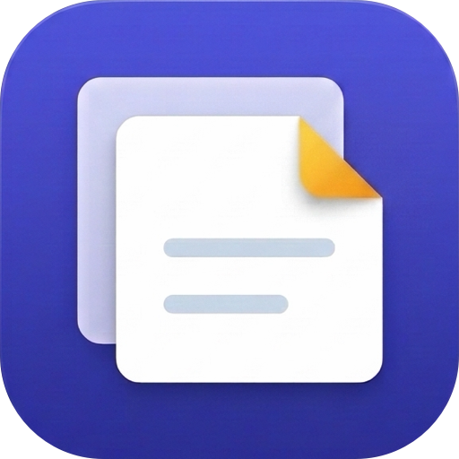
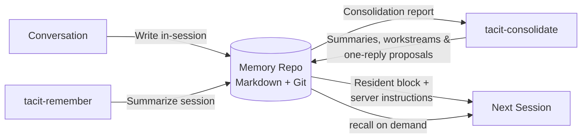
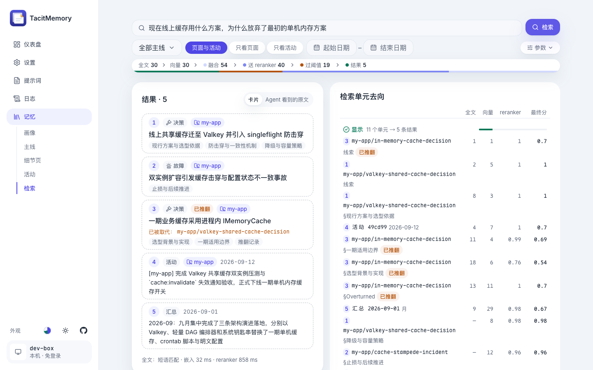
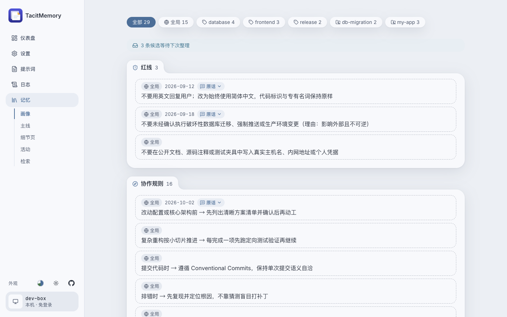
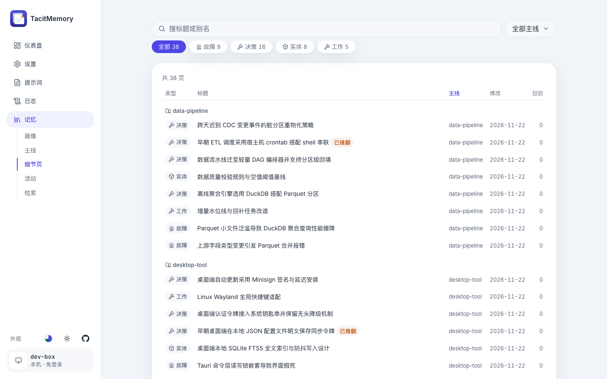
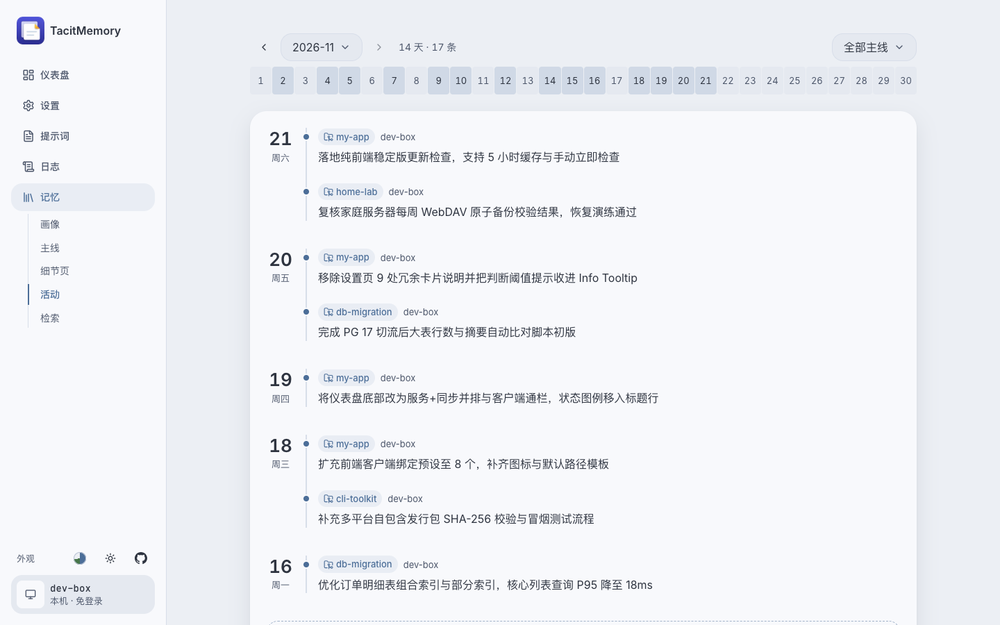
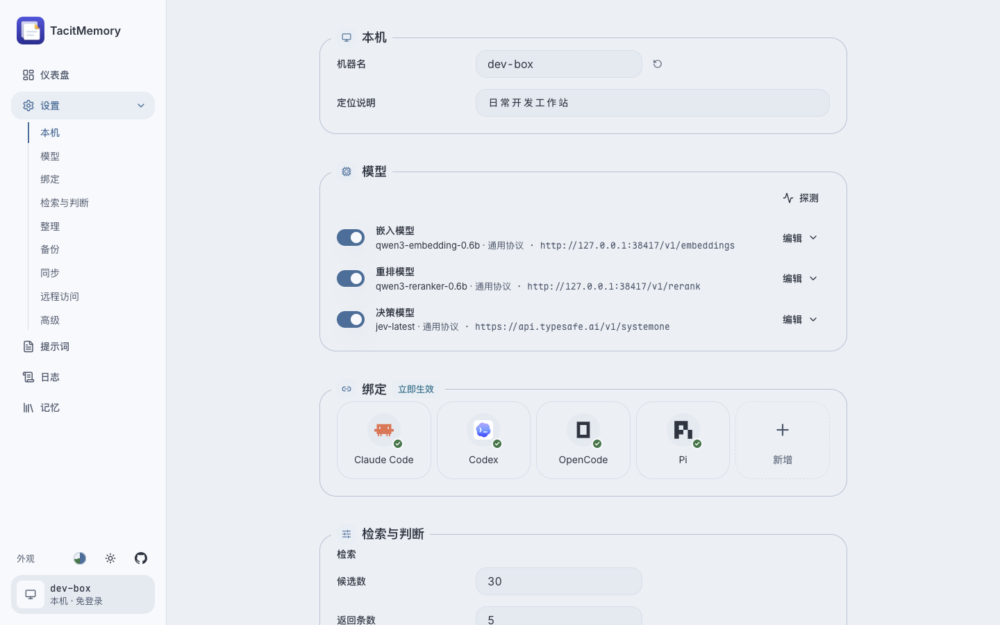

<div align="center">
  
  <h1>TacitMemory</h1>
  <p>A personal, white-box memory system shared across AI agent clients and machines. Stored as plain Markdown in Git and served over local HTTP MCP on macOS, Windows, and Linux.</p>
  <p>
    <a href="https://github.com/kearril/tacit-memory/releases"></a>
    <a href="LICENSE"></a>
    
    
    
    
  </p>
  <p>
    <strong>English</strong> · <a href="README.zh-CN.md">简体中文</a>
  </p>
</div>


## Why TacitMemory

**Your memory belongs to you, not to a single vendor or client.**

More AI platforms and coding assistants now ship built-in memory, yet once your working rules, preferences, troubleshooting notes, and project context live inside a vendor's cloud or proprietary format, they are hard to take with you when using multiple tools side by side or moving to a different platform—forcing you to explain the same background from scratch.

TacitMemory decouples personal memory from any specific vendor or client: everything is stored as plain Markdown in your local Git repository and connected to any agent through a context file, skills, and a local HTTP MCP endpoint. Different models and clients share the same white-box, portable, auditable long-term memory.

| Dimension | Vendor / Client Built-in Memory | Background LLM + Database Memory | **TacitMemory** |
| :--- | :--- | :--- | :--- |
| **Storage & readability** | Vendor cloud or client-private storage | Database primary store, hard to edit directly | **White-box Markdown + Git history**, readable, editable, and auditable |
| **Control & transparency** | Automatic writes, opaque internals | Black-box background extraction and rewrites | **Human-approved consolidation proposals** + built-in Web UI & pipeline-matched Recall Trace |
| **Ownership & overhead** | Locked to one vendor or client | Cross-client, but burns ongoing background LLM tokens | **Zero vendor lock-in, cross-client**, zero background generative LLM cost |

- **White-box Markdown + Git design**: Every memory is human-readable, editable in any text editor, and auto-committed to Git on write. The SQLite full-text and vector index is strictly a derived cache that can be deleted and rebuilt at any time, paired with a built-in Web UI and pipeline-matched **Recall Trace** showing why every result ranked where it did.
- **Cross-client & multi-machine sharing**: Works across MCP-compatible clients such as Claude Code, Codex, OpenCode, Pi, Antigravity, and DeepSeek Harness, supporting concurrent multi-agent reads and writes. Sync across machines through your own private Git repository.
- **Zero background generative LLMs**: Understanding, summarizing, and drafting consolidation proposals are performed by the main-session agent that already holds the full conversation context. The background service never silently rewrites past memories and incurs zero extra chat token cost.
- **Layered memory with progressive disclosure**: Global persona stays resident, domain rules and detail pages load on demand, and ongoing work condenses into workstream briefings—balancing low context noise with cross-session continuity.
- **Lightweight deployment with graceful degradation**: Runs in a single process at ~20 MB resident memory with no external database. The full experience is designed and tuned around three lightweight auxiliary models (strongly recommended for daily use), while degrading gracefully when omitted so you can trial it with zero model setup.

## Daily Workflow

1. **Automatic context at session start**: Global red lines, working rules, preferences, and active workstream background and recent progress load automatically—no need to re-introduce them each session.
2. **On-demand recall and in-session writes**: During a conversation, the agent queries past troubleshooting notes or decisions via `recall` and records durable conclusions or new rules following the write guidelines.
3. **Manual wrap-up capture (`tacit-remember`)**: Triggered manually by the user (no client hooks). Models with strong instruction-following typically handle memory writes and wrap-ups autonomously even across long-running tasks; weaker models generally recall memory reliably but may be less proactive about writing and summarizing, in which case running `tacit-remember` before compacting context or ending a task prompts them to capture session outcomes.
4. **Manual periodic consolidation (`tacit-consolidate`)**: Also triggered manually by the user. Run periodically or when notified that consolidation is due: the agent first auto-fixes formatting, writes weekly/monthly summaries, and updates workstream recents, then presents decisions as a numbered list for one-reply batch approval.
5. **Direct browsing and editing**: Inspect or search memories in the built-in Web UI, or edit any Markdown file under `~/.tacit/memory` directly in your own editor—the service watches for changes and reindexes automatically.

## Installation

Only **`git`** on `PATH` is required at runtime. All prebuilt packages are **self-contained binaries—no .NET 11 runtime or Bun required**, covering `win-x64`, `osx-arm64`, and `linux-x64`.

### Option 1: Let Your AI Agent Install & Configure It

If you already use an AI agent with shell access on this machine, send it the prompt below to read this repository's documentation and handle installation, initialization, background service setup, and binding/MCP wiring for your current client:

```text
Please read the documentation at https://github.com/kearril/tacit-memory, install and initialize TacitMemory on this machine, configure it to run as a background service, and complete binding and local HTTP MCP setup for your current client. Ask me to confirm before choosing the memory language or configuring auxiliary models and multi-machine Git sync.
```

### Option 2: Package Manager or Manual Install

**Homebrew (macOS Apple Silicon / Linux x64)**

```bash
brew install kearril/tap/tacit
# Upgrade (stop `tacit serve` first)
brew upgrade kearril/tap/tacit
```

**Scoop (Windows x64)**

```powershell
scoop bucket add kearril https://github.com/kearril/scoop-bucket
scoop install tacit
# Upgrade (stop `tacit serve` first)
scoop update tacit
```

<details>
<summary>Manual archive download / Build from source</summary>

**Manual download**: Download the archive for your platform from [GitHub Releases](https://github.com/kearril/tacit-memory/releases) (`tacit-<version>-win-x64.zip`, `tacit-<version>-osx-arm64.tar.gz`, `tacit-<version>-linux-x64.tar.gz`), extract it into an empty directory, and add it to `PATH` or create a symlink:

```bash
mkdir -p <install-dir> && tar -xzf tacit-<version>-osx-arm64.tar.gz -C <install-dir>
ln -s <install-dir>/tacit ~/.local/bin/tacit
```

**Build from source** (requires .NET 11 SDK and Bun):

```bash
dotnet publish src/TacitMemory.Cli -c Release -o <install-dir>
```

This produces a framework-dependent build (requires the ASP.NET Core 11 runtime). See [`docs/operations.md`](docs/operations.md) for self-contained builds or skipping the Web UI build.

</details>

## Quick Start

No external models are required to get started—3 steps bring up a working setup:

1. **Initialize configuration and the memory repository**

   ```bash
   tacit init
   ```

   Creates `config.yaml` and the memory repository under `~/.tacit`. Interactive terminals prompt for the memory language (`zh` or `en`); in scripts, pass `--language en` or `--language zh` explicitly.

2. **Start the background service**

   ```bash
   tacit serve
   ```

   Runs in the foreground by default (run it in a dedicated terminal or under your OS service manager). Once started, open `http://127.0.0.1:18888/` in your browser to access the Web UI.

3. **Bind a client and connect MCP**

   Open **Settings → Bindings** in the Web UI to bind a client: choose a built-in preset (Claude Code, Codex, OpenCode, Pi, Oh My Pi, Antigravity, DeepSeek Harness, Hermes) or enter custom context-file and skills-directory paths for any compatible client (`tacit connect` is also available from the CLI).

   Then add the local HTTP MCP endpoint to your client's MCP configuration (adjust field names to match your client) and start a new session for changes to take effect:

   ```json
   {
     "mcpServers": {
       "tacit": {
         "url": "http://127.0.0.1:18888/mcp"
       }
     }
   }
   ```

That is enough to start using TacitMemory. For regular long-term use, configuring all [three auxiliary models](#auxiliary-models) under **Settings → Models** in the Web UI is strongly recommended for full retrieval and deduplication quality. After upgrading to a version that adds or updates built-in skills, re-bind in the Web UI (or re-run `tacit connect`) to refresh links.

<details>
<summary>Advanced setup: Multi-machine Git sync, backups & scheduled consolidation checks</summary>

**Multi-machine Git sync** (syncs only the memory repository; config, prompts, bindings, and backups stay per machine):

1. Create an **empty** private Git repository (a self-hosted bare repo via `git init --bare`, or an empty private repo on a Git host without initializing a README).
2. On the first machine, set `sync.remote` under **Settings → Sync** in the Web UI (and assign a distinct `machine.name` to each machine), then run `tacit sync` to push initial history; the service automatically pulls and pushes around writes and on schedule afterward.
3. On each additional machine, run `tacit init --remote <repo-url>` to clone the same memory repository, then bind your clients and start `tacit serve` as usual.

Sync uses linear rebase with `merge=union` on append-only files (`recent/*.md`, `candidates.md`); on conflicts or diverged history, automatic sync pauses safely for manual resolution without losing local data. See [`docs/operations.md`](docs/operations.md) for details.

**Backup & restore**: Creates an automatic local backup after the first write each day under `~/.tacit/backups/` (keeping 7 by default), plus manual snapshots via `tacit backup` and optional WebDAV cloud backups. `tacit restore` previews changes before confirming and creates a safety backup automatically.

**Scheduled consolidation checks**: The service exposes a boolean consolidation-due signal via `tacit consolidation` and `GET /api/consolidation` (with a one-click copyable setup prompt on the dashboard) for clients that support scheduled checks.

</details>

<details>
<summary>Advanced setup: Access the Web UI from another device</summary>

1. On the host machine, open the Web UI and go to **Settings → Remote access** to set an access password.
2. In the same section, add **Extra listen addresses** (for example, a LAN/VPN IP or `0.0.0.0`), save, and restart `tacit serve`.
3. From another device, open `http://<address>:<port>/` and sign in with the password.

The `/mcp` endpoint always accepts loopback connections only. The service does not terminate TLS—passwords and keys travel in plaintext, so only expose extra listeners on a trusted network (such as an encrypted VPN).

</details>

---

## How It Works

### Memory Layers & Progressive Disclosure

| Layer | What it holds | How it enters context |
| :--- | :--- | :--- |
| **Persona** | Red lines, working rules, preferences, and profile (scoped globally, by domain, or by workstream) | Global entries and the domain index stay resident; domain rules and workstream rules are fetched on demand |
| **Workstreams** | Ongoing efforts (projects, ops, etc.) with a stable background and recent summary | Resident in the context file (recent summary included for workstreams active in the last 28 days); full briefing fetched in one call on entry |
| **Activities** | One-line session outcomes archived monthly, plus weekly and monthly summaries | Last 7 days delivered via MCP server instructions; older entries retrieved on demand |
| **Pages** | Topic-focused Markdown pages (`incident`, `decision`, `entity`, `work`) | Retrieved on demand by the agent via `recall`, with explicit `supersedes` evolution links |

### Workflow



### Interface & Security Boundary

- **4 MCP tools**: `recall` (hybrid search, full-page read, workstream brief, and persona/rules read), `write_page` (section-level page creation and updates), `write_recent` (append or rewrite daily activity outcomes), and `write_persona` (write persona entries or propose candidates).
- **1 MCP resource**: `tacit://consolidation-report`, generating the two-part consolidation report on demand without taking a tool slot or allowing unprompted model invocation.
- **3 built-in skills**: `tacit-memory` is read on demand by the agent before writing; `tacit-remember` and `tacit-consolidate` are triggered manually by the user (no client hooks).
- **Local security boundary**: Common secrets and credentials are blocked locally via regex before writing (never sent to external models), and `/mcp` accepts loopback connections only.

## Auxiliary Models

TacitMemory's hybrid retrieval, reranking, and write/consolidation deduplication are designed and tuned around having all **three lightweight HTTP auxiliary models** configured. All three may be left blank for a zero-config trial and degrade gracefully on outage without blocking writes; however, **configuring all three is strongly recommended for regular daily use** to achieve full semantic recall, reranking precision, and automatic duplicate/conflict detection.

| Model | Role | Protocols & Providers | Graceful Degradation |
| :--- | :--- | :--- | :--- |
| **Embedding** | Generates vectors for semantic retrieval and pre-judgment neighbor filtering | **OpenAI Embeddings** (compatible with OpenAI, Ollama, vLLM, `llama.cpp`, Cloudflare Workers AI, etc.) | Falls back to pure SQLite FTS5 full-text search (with Chinese support) |
| **Reranker** | Reranks and filters fused retrieval candidates | **Cohere / Jina Rerank**; built-in `provider: cloudflare` adapter for Cloudflare Workers AI | Returns RRF-fused ranking directly |
| **Decision** | Answers four structured multiple-choice checks (duplicate page, same-day topic, same preference, persona conflict) by scoring option probabilities with no free-text generation, split by dual thresholds into Certain / Uncertain / Negative | **System One** protocol (such as TypeSafe `jev-latest`); built-in `provider: cloudflare` adapter for Cloudflare Workers AI | Treats all checks as Uncertain, allowing writes through for review during consolidation |

Each model can point to any local inference server or compatible cloud API. Under **Settings → Models** in the Web UI, enter the full request URL (`url` is sent verbatim without appending paths) and API key, save, and click **Probe** in the card header to verify connectivity. If you start without models and add an embedding model later, run `tacit reindex` once to backfill vectors for existing memories.

<details>
<summary>Reference model setups & threshold notes (zero self-hosting & author's setup)</summary>

The following setups are provided purely as references—any compatible provider or deployment style works:

- **Zero self-hosting (Cloudflare Workers AI)**: Configure all three through the built-in `provider: cloudflare` adapter (Cloudflare Workers AI's Free plan includes a daily free allocation that is typically sufficient for personal daily use; see Cloudflare's pricing for current limits): `@cf/baai/bge-m3` via its OpenAI-compatible embeddings endpoint, `@cf/baai/bge-reranker-base` (`provider: cloudflare`), and `@cf/cloudflare/clef` or `@cf/cloudflare/clef-flash` (`provider: cloudflare`).
- **Author's reference setup (local retrieval + cloud judgment)**: Local **`Qwen3-Embedding`** (`0.6B` / `4B`) and **`Qwen3-Reranker`** (`0.6B` / `4B`) via `llama.cpp` or vLLM for low latency with local-only retrieval text, paired with cloud **TypeSafe `jev-latest`** for judgment.
- **Decision threshold note**: Default judgment thresholds are calibrated against TypeSafe `jev-latest`; before switching to another decision model (such as the Cloudflare Clef series), review thresholds in [`docs/configuration.md`](docs/configuration.md).

</details>

## Design Trade-offs

These three characteristics are deliberate trade-offs made in exchange for white-box transparency, user control, cross-client portability, and zero background LLM cost:

- **Memory quality depends on the main-session model**: Because the service runs no background generative LLM, when `recall` is called, what gets recorded, and how sharp consolidation proposals are all depend on how well your active agent model follows instructions. In practice, models with strong instruction-following typically recall and write autonomously—including wrapping up long-running tasks—without explicit prompting, whereas less proactive models generally recall well but may miss writes or end-of-task wrap-ups unless guided with `tacit-remember`. In return, you pay zero hidden token overhead and past memories are never silently rewritten.
- **Expects light human stewardship rather than a set-and-forget black box**: TacitMemory does not attach client hooks for silent post-session extraction; `tacit-remember` and `tacit-consolidate` are both manually triggered. Spending a minute or two periodically to confirm a numbered consolidation list keeps long-term memory free of hallucinated drift with every change reviewed by you.
- **Multi-machine & multi-agent sharing requires scoping awareness**: While explicit machine tags (`on <machine>`) and scoped layers (global / domain / workstream) isolate environment specifics, you still want to keep general habits separate from single-machine or single-client details during writes and consolidation.

If you treat personal memory as a portable, auditable long-term asset, these trade-offs are a natural price to pay—valuable assets require upkeep and do not maintain themselves, much like a garden cannot stay orderly without occasional pruning.

## Screenshots

The built-in **Recall Trace** runs queries through the exact same pipeline as an agent, letting you inspect full-text, vector, RRF fusion, evolution-graph expansion, rerank, and scoring/gating stages side by side to see why every memory matched or was filtered out:



<details>
<summary>Expand more screenshots (Persona, Workstreams, Pages, Activities, Prompts, Settings)</summary>

| Persona | Workstreams |
| :---: | :---: |
|  |  |

| Pages | Activities |
| :---: | :---: |
|  |  |

| Prompt Editor | Settings |
| :---: | :---: |
|  |  |

</details>

## Performance & Benchmarks

Local indexing and retrieval run inside a single process: SQLite FTS5 full-text search and zero-copy SIMD cosine vector scan (constant `O(K)` per-query allocation regardless of corpus size) are fused via RRF, followed by bounded 1-hop evolution-graph expansion over `supersedes` / `related`, reranking, white-box status/type/temporal adjustments, and two-layer adaptive gating.

Reference measurements on Apple Silicon (Release build, `1024`-dim vectors, excluding external model inference):

| Indexed Units | Cold Sync | Incremental Sync | FTS5 P50 | Vector P50 / Alloc | End-to-End P50 |
| ---: | ---: | ---: | ---: | ---: | ---: |
| 500 | 53.6 ms | 2.1 ms | 0.17 ms | 0.50 ms / 33.1 KB | 1.42 ms |
| 2,000 | 95.6 ms | 5.4 ms | 0.23 ms | 1.60 ms / 33.2 KB | 2.64 ms |
| 10,000 | 544.5 ms | 34.6 ms | 0.74 ms | 7.66 ms / 33.4 KB | 9.95 ms |

The repository ships a reproducible benchmark suite (`benchmarks/TacitMemory.Benchmarks`) with both `perf` and `recall` modes—including a built-in 38-page / 92-query de-personalized corpus and local model response cache—so you can benchmark embedding/reranker models or your own private corpus. With local `Qwen3-Embedding-0.6B` + `Qwen3-Reranker-0.6B` under default settings, the 92-query suite achieves **100.0% Recall@5**, **93.3% Hit@1**, **100.0% All@5**, **0.967 MRR**, and **52.9% negative abstention**. See [`docs/benchmarks.md`](docs/benchmarks.md) for usage and category breakdowns.

## Documentation

> Note: Detailed reference docs under `docs/` are currently written in Simplified Chinese.

- [`docs/design.md`](docs/design.md) — System behavior, memory rules, Web UI, and security boundaries
- [`docs/decisions.md`](docs/decisions.md) — Architectural decisions, rationale, and rejected alternatives
- [`docs/configuration.md`](docs/configuration.md) — Environment variables, `config.yaml`, and prompt customization
- [`docs/memory-files.md`](docs/memory-files.md) — Memory repository layout and Markdown file formats
- [`docs/operations.md`](docs/operations.md) — Backup/restore, Git sync, troubleshooting, and release packaging
- [`docs/development.md`](docs/development.md) — Codebase map, testing seams, and local builds
- [`docs/benchmarks.md`](docs/benchmarks.md) — Retrieval recall and index performance benchmark guide
- [`CHANGELOG.md`](CHANGELOG.md) — Release notes and version history

## License & Feedback

Released under the [Apache License 2.0](LICENSE). Third-party notices bundled in release archives are listed in `THIRD-PARTY-NOTICES.txt`. Questions, suggestions, and bug reports are welcome via [GitHub Issues](https://github.com/kearril/tacit-memory/issues).
