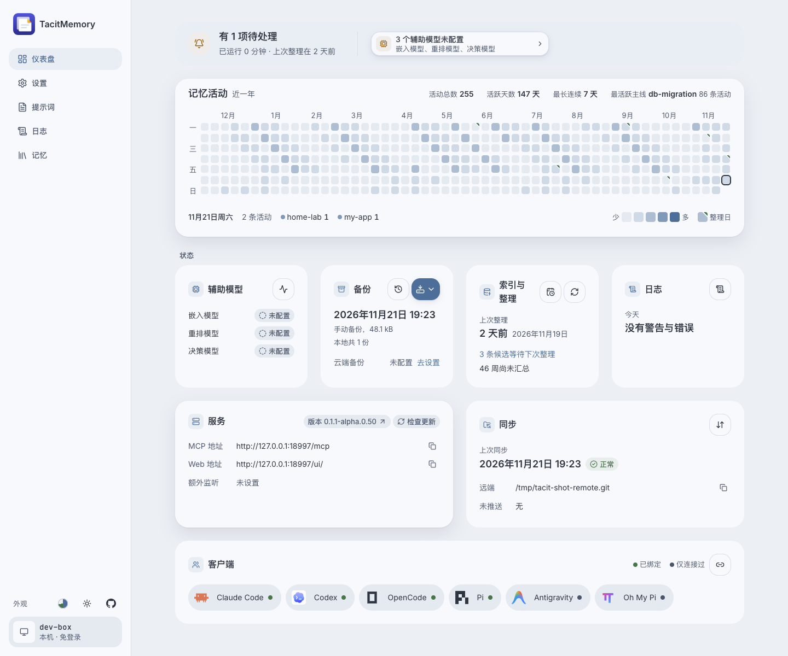
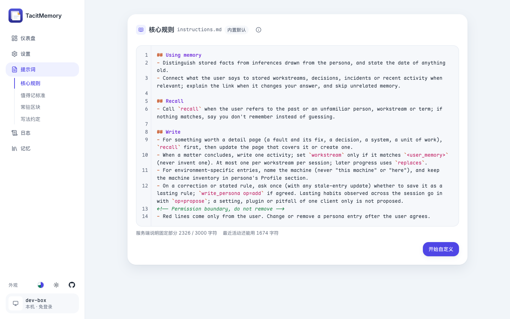
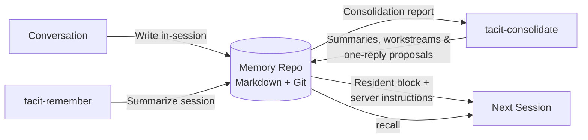

<div align="center">
  
  <h1>TacitMemory</h1>
  <p>A personal, white-box memory system shared across AI agent clients and machines—stored as plain Markdown in Git and served over local HTTP MCP on macOS, Windows, and Linux.</p>
  <p>
    <a href="https://github.com/kearril/tacit-memory/releases"></a>
    <a href="LICENSE"></a>
    
    
    
    
  </p>
  <p>
    <strong>English</strong> · <a href="README.zh-CN.md">简体中文</a>
  </p>
</div>



## Why TacitMemory

**Your memory belongs to you—not to a single vendor or client.**

More AI platforms and agent clients now ship built-in memory, yet once your working rules, preferences, troubleshooting lessons, and project context live inside a vendor's cloud or proprietary format, they become hidden lock-in. Whether you use multiple models and tools side by side or move to a better option later, that accumulated context is hard to take with you and ends up explained from scratch again.

TacitMemory decouples personal memory from any single vendor or client: it stores everything as plain, white-box Markdown files under Git and connects to any agent through just a context file, skills, and a local HTTP MCP endpoint. **Whichever model or client you choose, it shares the same portable, auditable long-term memory.**

| Dimension | Vendor / Client Built-in Memory | Background LLM + Database Memory | **TacitMemory** |
| :--- | :--- | :--- | :--- |
| **Storage & auditability** | Vendor cloud or client-private storage | Database primary store, hard to edit directly | **White-box Markdown + Git history**, readable, editable, and auditable |
| **Control & visibility** | Automatic writes, opaque internals | Background extraction/merging in a black box | **Human-approved consolidation proposals** + built-in Web UI & pipeline-matched Recall Trace |
| **Ownership & overhead** | Locked to one vendor or client | Cross-client, but burns ongoing background LLM tokens | **Zero vendor lock-in, cross-client**, zero background generative LLM cost |

## Key Features

- **Memory follows you, not a vendor or client**: Relies only on three universal primitives—a context file, skills, and a local HTTP MCP endpoint—working seamlessly across Claude Code, Codex, OpenCode, Pi, DeepSeek Harness, and more, with concurrent multi-agent reads and writes. Sync across multiple machines through your own private Git repository.
- **Zero background generative LLMs—predictable and low-cost**: Understanding, summarizing, and drafting consolidation proposals are all performed by the main-session agent that already holds the full conversation context. The background service never runs hidden LLM rewrites, burns zero extra chat tokens, and never silently mutates or deletes past memories.
- **Markdown + Git white-box storage**: Every memory is human-readable, editable in any text editor, and auto-committed on write. The SQLite full-text and vector index is strictly a derived cache that can be deleted and rebuilt at any time—zero vendor lock-in.
- **Layered memory with progressive disclosure**: Global persona stays resident, domain rules load on trigger, ongoing workstreams condense into structured briefings, and detailed notes are recalled on demand—balancing low token noise with high continuity.
- **Ultra-lightweight and minimal to start**: Runs at ~20 MB resident memory out of the box with no external database or heavy runtime dependencies. The three auxiliary models (embedding, reranker, and judgment) degrade gracefully when omitted or unavailable without blocking writes, though configuring all three is strongly recommended for the best retrieval and consolidation quality.
- **Built-in Web UI & pipeline-matched Recall Trace**: A single process serves memory browsing, a yearly activity heatmap, live editing for all four built-in prompts, and **Recall Trace** running the exact same retrieval pipeline as your agents so you can see why every result ranked where it did.

## Design Trade-offs

These three characteristics are deliberate trade-offs made in exchange for white-box transparency, user control, cross-client portability, and zero background LLM cost:

- **Memory quality depends on the main-session model**: Because the service runs no background generative LLM, when `recall` is called, what gets recorded, and how sharp consolidation proposals are all depend on how well your active agent model follows instructions. In return, you pay zero hidden token overhead and never lose control of your notes.
- **Not a "set-and-forget" black box—expects light human stewardship**: TacitMemory does not hook into clients for silent post-session extraction. You trigger `tacit-remember` before compacting context or wrapping up a task, and spend a minute or two periodically (or when notified by scheduled consolidation checks) confirming a numbered `tacit-consolidate` proposal list in one reply. In return, long-term memory stays free of hallucinated drift.
- **Multi-machine & multi-agent sharing requires scoping awareness**: When several machines and agents share one memory store, mixing machine-specific paths or client-specific quirks into global persona can pollute other environments. TacitMemory isolates these with explicit machine tags (`on <machine>`), scoped layers (global / domain / workstream), and write guidelines, though you still want to keep general habits separate from single-machine or single-client details during writes and consolidation.

If you treat personal memory as a portable, auditable long-term asset, these trade-offs are a natural price to pay—valuable assets require upkeep and do not maintain themselves, much like a garden cannot stay orderly without occasional pruning.

## Screenshots

Beyond the dashboard and yearly activity heatmap at the top, the built-in **Recall Trace** runs queries with the exact same parameters as an agent and lets you inspect full-text, vector, RRF fusion, and rerank stages side by side:


<details>
<summary>Expand more screenshots (Persona, Workstreams, Pages, Activities, Prompts, Settings)</summary>

| Persona | Workstreams |
| :---: | :---: |
|  |  |

| Pages | Activities |
| :---: | :---: |
|  |  |

| Prompt Editor | Settings |
| :---: | :---: |
|  |  |

</details>

## How It Works

### Memory Layers

| Layer | What it holds | How it enters context |
| :--- | :--- | :--- |
| **Persona** | Red lines, working rules, preferences, and profile (scoped globally, by domain, or by workstream) | Global entries and the domain index stay resident; domain rules and workstream rules are fetched on demand |
| **Workstreams** | Ongoing efforts (projects, ops, etc.) with a stable background and recent summary | Resident in the context file (recent summary included for workstreams active in the last 28 days) |
| **Activities** | One-line session outcomes archived monthly, plus weekly and monthly summaries | Last 7 days delivered via MCP server instructions; older entries retrieved on demand |
| **Pages** | Topic-focused Markdown pages (`incident`, `decision`, `entity`, `work`) | Retrieved on demand by the agent via `recall` |

### MCP Surface & Skills

To minimize context overhead and tool bloat, the service exposes a compact surface:

- **4 MCP tools**: `recall` (hybrid search, full-page read, workstream brief, and persona/rules read), `write_page` (section-level page creation and updates), `write_recent` (append or rewrite daily activity outcomes), and `write_persona` (write persona entries or propose candidates).
- **1 MCP resource**: `tacit://consolidation-report` (generates the two-part consolidation report on demand without taking a tool slot or letting the model invoke it unprompted).
- **3 built-in skills**: `tacit-memory` is read on demand by the agent before writing; **`tacit-remember` and `tacit-consolidate` are manually triggered by the user** (no client hooks or automatic background runs).
- **Local security boundary**: Common secrets and credentials are blocked locally via regex before writing (never sent to external models), and `/mcp` accepts loopback connections only.

### Workflow



## Auxiliary Models

TacitMemory supports three lightweight HTTP auxiliary models, **all optional**: when omitted or unavailable they degrade gracefully without blocking writes, though configuring all three noticeably improves semantic recall, reranking precision, and duplicate/conflict detection during writes and consolidation.

| Model | Role | Protocols & Providers | Graceful Degradation |
| :--- | :--- | :--- | :--- |
| **Embedding** | Generates vectors for semantic retrieval and pre-judgment neighbor filtering | **OpenAI Embeddings** (compatible with OpenAI, Ollama, vLLM, `llama.cpp`, Cloudflare Workers AI, etc.) | Falls back to pure SQLite FTS5 full-text search (with Chinese support) |
| **Reranker** | Reranks and filters RRF-fused full-text + vector candidates | **Cohere / Jina Rerank**; built-in `provider: cloudflare` adapter for Cloudflare Workers AI | Returns RRF-fused ranking directly |
| **Decision** | Answers four structured multiple-choice checks (duplicate page, same-day topic, same preference, persona conflict) by scoring option probabilities with no free-text generation, split by dual thresholds into Certain / Uncertain / Negative | **System One** protocol (structured probability-scoring API such as TypeSafe `jev-latest`); built-in `provider: cloudflare` adapter for Cloudflare Workers AI | Treats all checks as Uncertain, allowing writes through for review during consolidation |

### Recommended Setups

- **Local retrieval + cloud judgment (recommended)**: Run the Qwen family's **`Qwen3-Embedding`** (e.g. `Qwen3-Embedding-0.6B` / `4B`) and **`Qwen3-Reranker`** (e.g. `Qwen3-Reranker-0.6B` / `4B`) locally via `llama.cpp`, vLLM, or a similar inference server for low latency, local-only embeddings, and strong multilingual/code retrieval; pair them with **TypeSafe `jev-latest`** for judgment (built-in thresholds are calibrated on `jev-latest` for minimal false rejections).
- **Zero self-hosting cloud setup**: Configure all three over hosted APIs—for instance, using the built-in **Cloudflare Workers AI** adapter (`@cf/baai/bge-m3` via its OpenAI-compatible embeddings endpoint, `@cf/baai/bge-reranker-base` with `provider: cloudflare`, and `@cf/cloudflare/clef` or `@cf/cloudflare/clef-flash` with `provider: cloudflare`), or mix any OpenAI / Cohere / Jina / TypeSafe compatible services.
- **Zero-config trial**: Leave all three blank to start right away; after adding an embedding model later, run `tacit reindex` once to backfill vectors for existing memories.

> Enter the full request URL in `url`—the service sends requests as written without appending paths. Default judgment thresholds are calibrated against TypeSafe `jev-latest`; see [`docs/configuration.md`](docs/configuration.md) to review thresholds before switching to another decision model (such as the Cloudflare Clef series).

## Installation

Only **`git`** on `PATH` is required at runtime. Homebrew, Scoop, and GitHub Releases distribute **self-contained binaries—no .NET 11 runtime or Bun required** (only needed when building from source). Prebuilt binaries cover `win-x64`, `osx-arm64`, and `linux-x64`; build from source for other architectures.

### Let Your AI Agent Install & Configure It

If you already use an AI agent with shell access on this machine, send it the prompt below to read this repository's docs and handle installation, initialization, background service setup, and binding/MCP wiring for your current client:

```text
Please read the documentation at https://github.com/kearril/tacit-memory, install and initialize TacitMemory on this machine, configure it to run as a background service, and complete binding and local HTTP MCP setup for your current client. Ask me to confirm before choosing the memory language or configuring auxiliary models and multi-machine Git sync.
```

### Homebrew (macOS Apple Silicon / Linux x64)

```bash
brew install kearril/tap/tacit
# Upgrade (stop `tacit serve` first)
brew upgrade kearril/tap/tacit
```

### Scoop (Windows x64)

```powershell
scoop bucket add kearril https://github.com/kearril/scoop-bucket
scoop install tacit
# Upgrade (stop `tacit serve` first)
scoop update tacit
```

### Manual download

Download the release archive for your platform from [GitHub Releases](https://github.com/kearril/tacit-memory/releases) and extract it into an empty directory:

| Platform | Archive |
| :--- | :--- |
| Windows x64 | `tacit-<version>-win-x64.zip` |
| macOS (Apple Silicon) | `tacit-<version>-osx-arm64.tar.gz` |
| Linux x64 | `tacit-<version>-linux-x64.tar.gz` |

Add that directory to `PATH` or create a symlink:

```bash
mkdir -p <install-dir> && tar -xzf tacit-<version>-osx-arm64.tar.gz -C <install-dir>
ln -s <install-dir>/tacit ~/.local/bin/tacit
```

<details>
<summary>Build from source</summary>

Requires **.NET 11 SDK** and **Bun** (for building the Web UI):

```bash
dotnet publish src/TacitMemory.Cli -c Release -o <install-dir>
```

This produces a framework-dependent build (requires the ASP.NET Core 11 runtime). See [`docs/operations.md`](docs/operations.md) for self-contained builds or skipping the Web UI build.

</details>

## Quick Start

1. **Initialize configuration and the memory repository**

   ```bash
   tacit init
   ```

   Creates `config.yaml` and the memory repository under `~/.tacit`. Interactive terminals prompt for the memory language (`zh` or `en`); in scripts, pass `--language en` or `--language zh` explicitly.

2. **Start the background service**

   ```bash
   tacit serve
   ```

   Runs in the foreground by default (run it in a dedicated terminal or under your OS service manager). Once started, open `http://127.0.0.1:18888/` in your browser to access the Web UI.

3. **Bind a client and connect MCP**

   Open **Settings → Bindings** in the Web UI, pick a built-in client preset (Claude Code, Codex, OpenCode, Pi, Oh My Pi, Antigravity, DeepSeek Harness, Hermes) for one-click binding, and add the local HTTP MCP endpoint (`http://127.0.0.1:18888/mcp`) to your client's MCP configuration. Any client that supports a context file, skills, and local HTTP MCP can also be bound via the CLI:

   ```bash
   tacit connect --client my-agent --context ~/.my-agent/AGENTS.md --skills ~/.my-agent/skills
   ```

   Binding writes the resident memory block into your context file and links the `tacit-memory`, `tacit-remember`, and `tacit-consolidate` skills into the skills directory.

   Generic HTTP MCP configuration example (adjust field names to match your client):

   ```json
   {
     "mcpServers": {
       "tacit": {
         "url": "http://127.0.0.1:18888/mcp"
       }
     }
   }
   ```

   Start a new client session after binding and MCP setup for changes to take effect.

4. **Configure the three auxiliary models** (optional, strongly recommended)

   In the Web UI, open **Settings → Models**, enter the endpoints and API keys for the embedding, reranker, and judgment models, save, and click **Probe** in the card header to verify connectivity.

<details>
<summary>Multi-machine Git sync & backups</summary>

**Multi-machine Git sync** (syncs only the memory repository; config, prompts, bindings, and backups stay per machine):

1. Create an **empty** private Git repository (a self-hosted bare repo via `git init --bare`, or an empty private repo on a Git host without initializing a README).
2. On the first machine, set `sync.remote` under **Settings → Sync** in the Web UI (and give each machine a distinct `machine.name`), then run `tacit sync` to push initial history; the service automatically pulls and pushes around writes and on schedule afterward.
3. On each additional machine, run `tacit init --remote <repo-url>` to clone the same memory repository, then bind your clients and start `tacit serve` as usual.

Sync uses linear rebase with `merge=union` on append-only files (`recent/*.md`, `candidates.md`); on conflicts or diverged history, automatic sync pauses safely for manual resolution without losing local data. See [`docs/operations.md`](docs/operations.md) for details.

**Backup & restore**: Creates an automatic local backup after the first write each day under `~/.tacit/backups/` (keeping 7 by default), plus manual snapshots via `tacit backup` and optional WebDAV cloud backups. `tacit restore` previews changes before confirming and creates a safety backup automatically.

</details>

<details>
<summary>Access the Web UI from another device</summary>

1. On the host machine, open the Web UI and go to **Settings → Remote access** to set an access password.
2. In the same section, add **Extra listen addresses** (for example, a LAN/VPN IP or `0.0.0.0`), save, and restart `tacit serve`.
3. From another device, open `http://<address>:<port>/` and sign in with the password.

The `/mcp` endpoint always accepts loopback connections only. The service does not terminate TLS—passwords and keys travel in plaintext, so only expose extra listeners on a trusted network (such as an encrypted VPN).

</details>

## Daily Usage

- **Automatic injection & on-demand recall**: Every new session loads the resident block and MCP server instructions automatically; during a conversation, the agent reads via `recall` and writes via `write_*` (keep `tacit serve` running).
- **Workstream briefings**: When entering an ongoing workstream, the agent calls `recall` with only `workstream` to load its rules, open items, page directory, and recent activity in one shot.
- **Manual capture (`tacit-remember`)**: Trigger `tacit-remember` before compacting context or ending a session to summarize and store outcomes immediately.
- **Periodic consolidation & scheduled reminders (`tacit-consolidate`)**: When notified that consolidation is due, run `tacit-consolidate`—the agent auto-fixes formatting, cleans redundant candidates, writes weekly/monthly summaries, updates workstream recents, and presents decisions as a numbered list for one-reply batch approval. The service also exposes a boolean signal via `tacit consolidation` and `GET /api/consolidation` (with a one-click copyable setup prompt on the dashboard) for clients that support scheduled checks.
- **Direct editing**: Edit any Markdown file under `~/.tacit/memory` in your own editor; the service watches for changes and reindexes automatically.
- **Syncing skills after upgrades**: When built-in skills are added or updated, re-run `tacit connect` with the same flags to refresh links.

## Documentation

> Note: Detailed reference docs under `docs/` are currently written in Simplified Chinese.

- [`docs/design.md`](docs/design.md) — System behavior, memory rules, Web UI, and security boundaries
- [`docs/decisions.md`](docs/decisions.md) — Architectural decisions, rationale, and rejected alternatives
- [`docs/configuration.md`](docs/configuration.md) — Environment variables, `config.yaml`, and prompt customization
- [`docs/memory-files.md`](docs/memory-files.md) — Memory repository layout and Markdown file formats
- [`docs/operations.md`](docs/operations.md) — Backup/restore, Git sync, troubleshooting, and release packaging
- [`docs/development.md`](docs/development.md) — Codebase map, testing seams, and local builds
- [`CHANGELOG.md`](CHANGELOG.md) — Release notes and version history

## License & Feedback

Released under the [Apache License 2.0](LICENSE). Third-party notices bundled in release archives are listed in `THIRD-PARTY-NOTICES.txt`. Questions, suggestions, and bug reports are welcome via [GitHub Issues](https://github.com/kearril/tacit-memory/issues).
