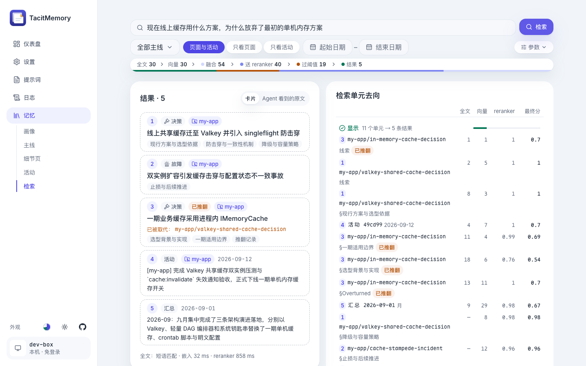
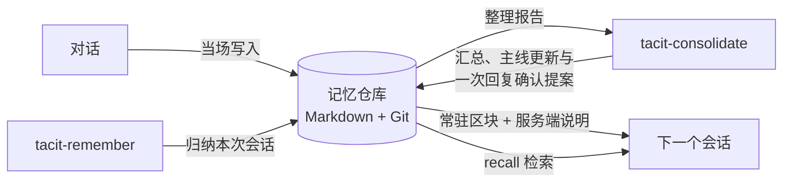

<div align="center">
  
  <h1>TacitMemory</h1>
  <p>跨客户端、跨机器共用的个人白盒记忆系统——以 Markdown 与 Git 存留，经本地 HTTP MCP 与所有 AI Agent 共享，支持 macOS、Windows 与 Linux。</p>
  <p>
    <a href="https://github.com/kearril/tacit-memory/releases"></a>
    <a href="LICENSE"></a>
    
    
    
    
  </p>
  <p>
    <a href="README.md">English</a> · <strong>简体中文</strong>
  </p>
</div>


## 为什么做 TacitMemory

**工具可以随时换，记忆不该每次归零。**

AI 模型与 Agent 客户端迭代极快——今天在用 Claude Code，明天换到 Codex、OpenCode 或 Pi，后天又迁往新工具，甚至曾经顺手的客户端某天停止维护。每次切换，最耗心力的往往不是重新装环境，而是把你的协作规则、习惯偏好、踩过的坑与推进中的项目，对着一个从零开始的「新同事」再讲一遍。

TacitMemory 将个人记忆从具体客户端中彻底剥离：以纯 Markdown 与 Git 存成属于你的白盒资产，仅依靠上下文文件、skill 与本地 HTTP MCP 接入任意 Agent。**新客户端一连上，就能延续先前的默契继续协作。**

## 核心特点

- **记忆跟着人走，不绑死客户端与模型厂商**：仅依赖上下文文件、skill 与本地 HTTP MCP 三项通用机制，一套记忆通吃 Claude Code、Codex、OpenCode、Pi、DeepSeek Harness 等客户端，并支持多 Agent 并发读取与同时写入；多台设备经你自己的私有 Git 仓库自动同步与共享。
- **零后台生成式 LLM，确定且省心**：理解、归纳与整理提案均由拥有完整上下文的主会话 Agent 完成；常驻服务不做后台暗箱改写，不额外消耗对话 Token，也不会悄悄篡改或误删旧记忆。
- **Markdown + Git 白盒设计**：所有记忆人眼可读、任意编辑器可手改、每次写入自动提交；SQLite 全文与向量索引只是随时可删可重建的派生缓存，永不数据锁定。
- **分层记忆设计与渐进式披露**：全局画像常驻、领域规则按触发词按需读取、持续事务沉淀为全景主线简报、历史细节按需召回，在低 Token 噪声与高连续性之间取得平衡。
- **极致轻量，极简起步**：常驻内存占用仅约 20 MB，解压即运行，无重型数据库与框架依赖；嵌入、重排与决策三个辅助模型缺省或故障时自动降级，不阻塞写入，但强烈推荐配齐这三个辅助模型以获得最佳体验。
- **内置现代 Web UI 与同口径检索追踪**：单进程提供记忆浏览、年度活动热力图、四份提示词在线调优，以及与 Agent 完全同管线的 **检索追踪（Recall Trace）**，每条记忆为何命中或落选一目了然。

## 设计取舍

以下三点并非偶然欠缺，而是为换取「白盒、可控、跨端通用与零后台开销」做出的刻意取舍，使用前值得了解：

- **记忆质量取决于主会话模型**：服务本身不运行后台生成式 LLM，何时调用 `recall`、记录什么结论以及整理提案的质量，均取决于你当前对话所使用的主 Agent 模型对规则的遵循能力；作为回报，服务不会产生额外对话 Token 消耗，也不会在后台擅自改写旧记忆。
- **非「装完就忘」的全自动黑盒，需要轻量人工配合**：不接入客户端钩子做会话后自动抽取，日常建议在压缩上下文或结束任务前触发 `tacit-remember`，每隔一段时间（或收到定时整理提醒时）花一两分钟批量回复一次 `tacit-consolidate` 的提案清单；换来的是长期记忆零幻觉污染、每一条都经你把关。
- **多端共享需要留意跨机与跨客户端串味**：多台设备与多个 Agent 共用同一套记忆时，若将单机环境细节或某个客户端的私有配置混入全局画像，会对其他环境造成干扰。TacitMemory 通过显式机器标识（`on <机器名>`）、作用域分层（全局 / 领域 / 主线）与写入规范加以隔离，但日常写入与整理时仍需留意区分「通用个人习惯」与「单机 / 单客户端细节」。

## 界面一览

除了顶部的仪表盘与年度记忆热力图，内置的 **检索追踪** 可使用与 Agent 完全一致的参数执行查询，逐阶段对比全文、向量、RRF 融合与精排结果：



<details>
<summary>展开查看更多界面截图（画像、主线、细节页、活动时间线、提示词、设置）</summary>

| 画像（Persona） | 主线简报（Workstreams） |
| :---: | :---: |
|  |  |

| 细节页（Pages） | 活动时间线（Activities） |
| :---: | :---: |
|  |  |

| 提示词编辑器（Prompts） | 可视化设置（Settings） |
| :---: | :---: |
|  |  |

</details>

## 工作方式

### 记忆分层

| 记忆层 | 内容 | 进入上下文的方式 |
| :--- | :--- | :--- |
| **画像** | 红线、协作规则、偏好与档案（分全局、领域、主线三种作用域） | 全局条目与领域索引常驻；领域规则与主线约定按需读取 |
| **主线** | 持续进行的事务（项目、运维等），含背景说明与近期摘要 | 随会话常驻（最近 28 天活跃的主线附近期摘要） |
| **活动记录** | 一行一条的会话结论（按月归档），整理时生成周/月汇总 | 最近 7 天随服务端说明下发，更早记录按需检索 |
| **细节页** | 按主题组织的 Markdown 页面（`incident`、`decision`、`entity`、`work`） | 由 Agent 通过 `recall` 按需检索 |

### 工作流程



## 前置要求

- **Git**：命令行可直接调用。
- **辅助模型**（可选，但建议配齐）：支持嵌入模型（OpenAI Embeddings）、reranker（Cohere / Jina Rerank）与决策模型（System One），内置提供方适配另支持 Cloudflare Workers AI（reranker、决策模型与嵌入模型）。三者均不强制配置，缺省或不可用时自动降级。内置判断阈值基于 TypeSafe `jev-latest` 标定，更换决策模型前请参阅 [`docs/configuration.md`](docs/configuration.md)。

## 安装

### Homebrew（macOS Apple Silicon / Linux x64）

```bash
brew install kearril/tap/tacit
```

### Scoop（Windows x64）

```powershell
scoop bucket add kearril https://github.com/kearril/scoop-bucket
scoop install tacit
```

### 手动下载预编译包

从 [GitHub Releases](https://github.com/kearril/tacit-memory/releases) 下载对应平台的发行包并解压至空目录：

| 平台 | 发行包 |
| :--- | :--- |
| Windows x64 | `tacit-<版本>-win-x64.zip` |
| macOS（Apple Silicon） | `tacit-<版本>-osx-arm64.tar.gz` |
| Linux x64 | `tacit-<版本>-linux-x64.tar.gz` |

将该目录加入 `PATH`，或建立符号链接：

```bash
mkdir -p <安装目录> && tar -xzf tacit-<版本>-osx-arm64.tar.gz -C <安装目录>
ln -s <安装目录>/tacit ~/.local/bin/tacit
```


<details>
<summary>从源码构建</summary>

需要 **.NET 11 SDK**、**Bun**（构建 Web 界面）：

```bash
dotnet publish src/TacitMemory.Cli -c Release -o <安装目录>
```

该命令生成依赖框架的产物（需预装 ASP.NET Core 11 运行时）。构建自包含发行包或跳过 Web 构建的方式见 [`docs/operations.md`](docs/operations.md)。

</details>

## 快速开始

1. **初始化配置与记忆仓库**

   ```bash
   tacit init
   ```

   在 `~/.tacit` 下生成 `config.yaml` 与记忆仓库。交互式终端会提示选择记忆语言（`zh` 或 `en`）；脚本环境下请显式传入 `--language zh` 或 `--language en`。

2. **启动常驻服务**

   ```bash
   tacit serve
   ```

   默认前台运行（建议放独立终端或交由系统服务管理器托管）。启动后打开浏览器访问 `http://127.0.0.1:18888/` 即可进入 Web 界面。

3. **绑定客户端并接入 MCP**

   在 Web 界面的 **「设置 → 绑定」** 中选择常用客户端预设（已内置 Claude Code、Codex、OpenCode、Pi 等路径模板）一键绑定，随后将页面显示的本地 HTTP MCP 端点（`http://127.0.0.1:18888/mcp`）添加到客户端的 MCP 配置中。

   偏好命令行也可直接执行：

   ```bash
   tacit connect --client my-agent --context ~/.my-agent/AGENTS.md --skills ~/.my-agent/skills
   ```

   绑定会在上下文文件写入常驻区块，并在 skill 目录建立 `tacit-memory`、`tacit-remember`、`tacit-consolidate` 三个链接。新建客户端会话即可生效。

4. **配置三个辅助模型**（可选，但强烈推荐）

   在 Web 界面的 **「设置 → 模型」** 中填写嵌入、重排与决策三个辅助模型的端点与密钥，保存后点击卡片右上角 **探测** 验证连通性。

<details>
<summary>跨设备访问 Web 界面</summary>

1. 在本机打开 Web 界面，进入 **「设置 → 远程访问」** 设置访问密码。
2. 在同一节填写 **额外监听地址**（例如内网/虚拟专网 IP 或 `0.0.0.0`），保存后重启 `tacit serve`。
3. 在其他设备访问 `http://<地址>:<端口>/` 并输入访问密码登录。

`/mcp` 端点始终只接受本机回环连接。服务不内置 HTTPS，访问密码与密钥以明文传输，请仅在可信网络（如加密虚拟专网）中开放额外监听。

</details>

## 日常使用

- **自动注入与按需检索**：会话开始时自动加载常驻区块与服务端说明；对话过程中 Agent 经 `recall` 检索、经 `write_*` 写入（需保持 `tacit serve` 运行）。
- **读取主线简报**：进入某条主线时，Agent 仅传入 `workstream` 调用 `recall`，一次性获取主线约定、未决事项、页目录与近期活动。
- **手动触发记录（`tacit-remember`）**：压缩上下文或结束会话前触发 `tacit-remember`，立即归纳并写入本次会话结论。
- **定期整理与定时提醒（`tacit-consolidate`）**：收到整理提示时触发 `tacit-consolidate`，Agent 先自动修正格式、清理冗余候选、写周/月汇总并更新主线近况，再把需拍板的提案整理为编号清单，由你一次回复批量确认。服务另提供 `tacit consolidation` 与 `GET /api/consolidation` 布尔信号（仪表盘可一键复制配置指令），方便在支持定时任务的客户端中配置自动巡检提醒。
- **直接编辑记忆文件**：可用任意编辑器直接修改 `~/.tacit/memory` 下的 Markdown，服务会监听变更并自动同步索引。
- **升级后同步 skill**：新增或更新内置 skill 后，用相同参数重跑一次 `tacit connect` 即可补齐链接。

## 文档导航

- [`docs/design.md`](docs/design.md) — 系统行为、记忆规则、Web 界面与安全边界
- [`docs/decisions.md`](docs/decisions.md) — 设计决策、权衡依据与未选方案
- [`docs/configuration.md`](docs/configuration.md) — 环境变量、`config.yaml` 与提示词自定义
- [`docs/memory-files.md`](docs/memory-files.md) — 记忆仓库目录结构与 Markdown 格式
- [`docs/operations.md`](docs/operations.md) — 备份恢复、Git 同步、排障与发布流程
- [`docs/development.md`](docs/development.md) — 代码架构、测试接缝与本地构建

## 许可

采用 [Apache License 2.0](LICENSE) 开源许可发布。发行包中附带的第三方许可声明见包内 `THIRD-PARTY-NOTICES.txt`。
