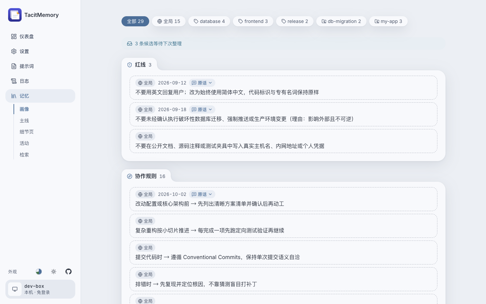
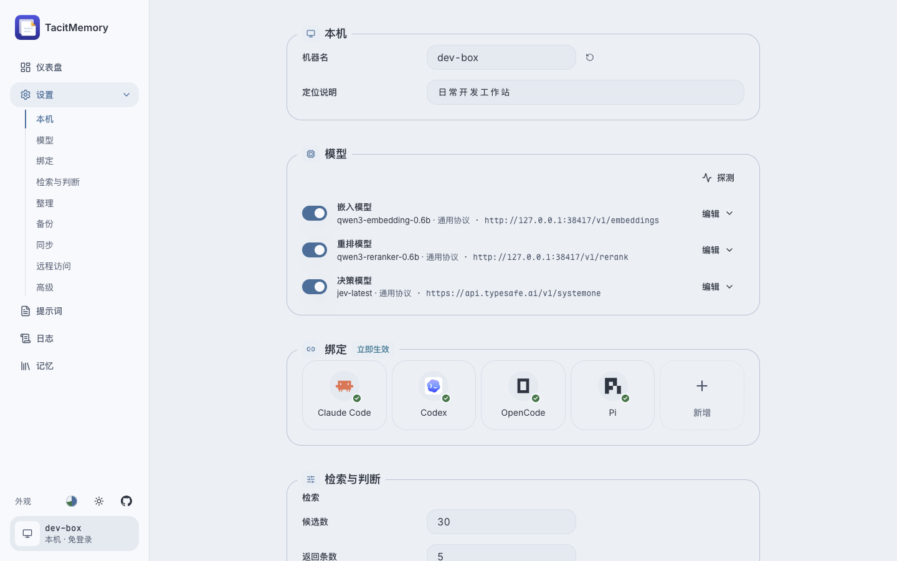
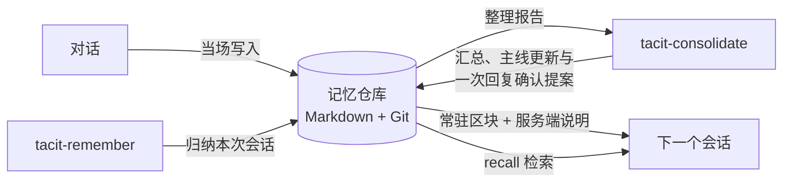

<div align="center">
  
  <h1>TacitMemory</h1>
  <p>跨客户端、跨机器共用的个人白盒记忆系统——以 Markdown 与 Git 存留，经本地 HTTP MCP 与所有 AI Agent 共享，支持 macOS、Windows 与 Linux。</p>
  <p>
    <a href="https://github.com/kearril/tacit-memory/releases"></a>
    <a href="LICENSE"></a>
    
    
    
    
  </p>
  <p>
    <a href="README.md">English</a> · <strong>简体中文</strong>
  </p>
</div>


## 为什么做 TacitMemory

**记忆属于你，不该被锁在某一家厂商或客户端里。**

越来越多 AI 平台与 Agent 工具开始内置记忆功能，但记忆一旦沉淀在单一厂商的云端或私有结构中，就会形成隐形的厂商锁定——无论是同时混用多家模型与客户端，还是日后迁往更合适的工具，你积累下来的协作规则、习惯偏好、排错经验与项目上下文往往带不走，只能在新环境里从零讲起。

TacitMemory 将个人记忆从具体厂商与客户端中彻底解耦：以纯 Markdown 与 Git 存成完全归你掌控的白盒资产，仅依靠上下文文件、skill 与本地 HTTP MCP 接入任意 Agent。**无论选择哪家模型或客户端，都能共享同一份可迁移、可审计的长期记忆。**

| 维度 | 厂商 / 客户端内置记忆 | 后台 LLM + 数据库记忆 | **TacitMemory** |
| :--- | :--- | :--- | :--- |
| **存储与审计** | 厂商云端或客户端私有存储 | 数据库为主存储，难直接编辑 | **纯白盒 Markdown + Git 历史**，随时可读、可手改、可回溯 |
| **可控与可视化** | 自动写入，过程不易观察 | 后台自动抽取合并，决策过程黑盒 | **人工拍板整理提案** + 内置 Web 界面与同口径检索追踪 |
| **归属与后台成本** | 锁定在单一厂商或客户端 | 可跨端，但后台持续消耗生成 Token | **无厂商锁定、跨端共享**，零后台生成式 LLM 成本 |

## 核心特点

- **记忆跟着人走，不绑死客户端与模型厂商**：仅依赖上下文文件、skill 与本地 HTTP MCP 三项通用机制，一套记忆通吃 Claude Code、Codex、OpenCode、Pi、DeepSeek Harness 等客户端，并支持多 Agent 并发读取与同时写入；多台设备经你自己的私有 Git 仓库自动同步与共享。
- **零后台生成式 LLM，确定且省心**：理解、归纳与整理提案均由拥有完整上下文的主会话 Agent 完成；常驻服务不做后台暗箱改写，不额外消耗对话 Token，也不会悄悄篡改或误删旧记忆。
- **Markdown + Git 白盒设计**：所有记忆人眼可读、任意编辑器可手改、每次写入自动提交；SQLite 全文与向量索引只是随时可删可重建的派生缓存，永不数据锁定。
- **分层记忆设计与渐进式披露**：全局画像常驻、领域规则按触发词按需读取、持续事务沉淀为全景主线简报、历史细节按需召回，在低 Token 噪声与高连续性之间取得平衡。
- **极致轻量，极简起步**：常驻内存占用仅约 20 MB，解压即运行，无重型数据库与框架依赖；嵌入、重排与决策三个辅助模型缺省或故障时自动降级，不阻塞写入，但强烈推荐配齐这三个辅助模型以获得最佳体验。
- **内置现代 Web UI 与同口径检索追踪**：单进程提供记忆浏览、年度活动热力图、四份提示词在线调优，以及与 Agent 完全同管线的 **检索追踪（Recall Trace）**，每条记忆为何命中或落选一目了然。

## 设计取舍

以下三点并非偶然欠缺，而是为换取「白盒、可控、跨端通用与零后台开销」做出的刻意取舍，使用前值得了解：

- **记忆质量取决于主会话模型**：服务本身不运行后台生成式 LLM，何时调用 `recall`、记录什么结论以及整理提案的质量，均取决于你当前对话所使用的主 Agent 模型对规则的遵循能力；作为回报，服务不会产生额外对话 Token 消耗，也不会在后台擅自改写旧记忆。
- **非「装完就忘」的全自动黑盒，需要轻量人工配合**：不接入客户端钩子做会话后自动抽取，日常建议在压缩上下文或结束任务前触发 `tacit-remember`，每隔一段时间（或收到定时整理提醒时）花一两分钟批量回复一次 `tacit-consolidate` 的提案清单；换来的是长期记忆零幻觉污染、每一条都经你把关。
- **多端共享需要留意跨机与跨客户端串味**：多台设备与多个 Agent 共用同一套记忆时，若将单机环境细节或某个客户端的私有配置混入全局画像，会对其他环境造成干扰。TacitMemory 通过显式机器标识（`on <机器名>`）、作用域分层（全局 / 领域 / 主线）与写入规范加以隔离，但日常写入与整理时仍需留意区分「通用个人习惯」与「单机 / 单客户端细节」。

如果你把个人记忆看作一份可迁移、可审计的长期个人资产，这些投入就是自然代价——有价值的资产需要维护，不会凭空得来，就像你不能指望一座从不修剪的花园自己一直井然有序。

## 界面一览

除了顶部的仪表盘与年度记忆热力图，内置的 **检索追踪** 可使用与 Agent 完全一致的参数执行查询，逐阶段对比全文、向量、RRF 融合与精排结果：


<details>
<summary>展开查看更多界面截图（画像、主线、细节页、活动时间线、提示词、设置）</summary>

| 画像（Persona） | 主线简报（Workstreams） |
| :---: | :---: |
|  |  |

| 细节页（Pages） | 活动时间线（Activities） |
| :---: | :---: |
|  |  |

| 提示词编辑器（Prompts） | 可视化设置（Settings） |
| :---: | :---: |
|  |  |

</details>

## 工作方式

### 记忆分层

| 记忆层 | 内容 | 进入上下文的方式 |
| :--- | :--- | :--- |
| **画像** | 红线、协作规则、偏好与档案（分全局、领域、主线三种作用域） | 全局条目与领域索引常驻；领域规则与主线约定按需读取 |
| **主线** | 持续进行的事务（项目、运维等），含背景说明与近期摘要 | 随会话常驻（最近 28 天活跃的主线附近期摘要） |
| **活动记录** | 一行一条的会话结论（按月归档），整理时生成周/月汇总 | 最近 7 天随服务端说明下发，更早记录按需检索 |
| **细节页** | 按主题组织的 Markdown 页面（`incident`、`decision`、`entity`、`work`） | 由 Agent 通过 `recall` 按需检索 |

### MCP 能力面与 Skill

为了尽量降低对 Agent 上下文与工具列表的占用，服务只暴露极简接口：

- **4 个 MCP 工具**：`recall`（混合检索、读整页、主线简报与画像/规则读取）、`write_page`（按小节创建或更新细节页）、`write_recent`（写入或改写当日活动结论）、`write_persona`（写入画像条目或提交候选）。
- **1 个 MCP 资源**：`tacit://consolidation-report`（整理时现场计算两段式报告，不占工具槽位，也不会被模型擅自调用）。
- **3 个内置 Skill**：`tacit-memory` 由 Agent 在写入前按需读取；**`tacit-remember` 与 `tacit-consolidate` 需要由用户手动调用触发**（不依赖客户端钩子自动运行）。
- **本地安全边界**：写入前在本地通过正则拦截常见密钥与凭据（不向外部模型外发原文），`/mcp` 端点严格仅监听本机回环地址。

### 工作流程



## 辅助模型

TacitMemory 可接入三类轻量级辅助模型（均经 HTTP 调用且**全部可选**）：缺省或故障时自动降级，不阻塞写入；配齐三者可显著提升语义召回精度、精排效果，以及写入与整理时的自动判重与冲突检测质量。

| 模型 | 职责 | 支持协议与提供方 | 缺省或不可用时的降级 |
| :--- | :--- | :--- | :--- |
| **嵌入模型（Embedding）** | 生成文本向量，用于语义检索与判断前近邻筛选 | **OpenAI Embeddings**（兼容 OpenAI、Ollama、vLLM、`llama.cpp`、Cloudflare Workers AI 等） | 退回纯 SQLite FTS5 全文检索（支持中文） |
| **重排模型（Reranker）** | 对全文 + 向量 RRF 融合结果精排与低分过滤 | **Cohere / Jina Rerank**；内置 `provider: cloudflare` 适配 Cloudflare Workers AI | 直接按 RRF 融合排序返回 |
| **决策模型（Decision）** | 回答四类结构化选择题（重复页、同日同主题、同一偏好、画像冲突），仅对选项输出概率、不生成自由文本，按双阈值分为「确定 / 不确定 / 否定」 | **System One** 协议（面向结构化决策的概率打分接口，如 TypeSafe `jev-latest`）；内置 `provider: cloudflare` 适配 Cloudflare Workers AI | 所有判断按「不确定」放行，留待整理阶段由主会话 Agent 复核 |

### 推荐搭配方案

- **本地检索 + 云端决策（推荐）**：本地通过 `llama.cpp`、vLLM 等推理服务运行千问家族的 **`Qwen3-Embedding`**（如 `Qwen3-Embedding-0.6B` / `4B`）与 **`Qwen3-Reranker`**（如 `Qwen3-Reranker-0.6B` / `4B`），兼顾低延迟、数据不出本机以及优秀的中英文与代码检索表现；决策模型接入 **TypeSafe `jev-latest`**（内置判断阈值基于该模型标定，误拒率最低）。
- **零自部署云端方案**：不想本地部署模型时，可直接利用内置的 **Cloudflare Workers AI** 适配一站配齐（其 Free 方案提供每日免费额度，个人日常使用通常足够，具体以 Cloudflare 官方政策为准）——嵌入 `@cf/baai/bge-m3`（OpenAI 兼容端点）、重排 `@cf/baai/bge-reranker-base`（`provider: cloudflare`）、决策 `@cf/cloudflare/clef` 或 `@cf/cloudflare/clef-flash`（`provider: cloudflare`）；也可按需混搭其他 OpenAI / Cohere / Jina / TypeSafe 兼容接口。
- **零配置先试跑**：三者全部留空即可启动使用；后续补配嵌入模型后，执行一次 `tacit reindex` 即可为历史记忆补全向量。

> `url` 须填写完整接口请求地址，程序原样请求、不自动拼接路径。内置判断阈值基于 TypeSafe `jev-latest` 标定，换用其他决策模型（如 Cloudflare Clef 系列）前请参阅 [`docs/configuration.md`](docs/configuration.md) 按需核对阈值。

## 安装

运行时仅需本机 `PATH` 中有 **`git`**。Homebrew、Scoop 与 GitHub Releases 提供的均为**自包含预编译包，无需预装 .NET 11 运行时或 Bun**（仅从源码构建时需要）。预编译包覆盖 `win-x64`、`osx-arm64` 与 `linux-x64`，其他架构请从源码构建。

### 交由 AI Agent 自动安装与配置

如果本地已有支持终端命令的 AI Agent，可直接将下方提示词发给它，由它读取本仓库文档完成安装、初始化、后台常驻与当前客户端的接入：

```text
请阅读 https://github.com/kearril/tacit-memory 的文档，在当前机器上为我安装并初始化 TacitMemory，配置后台常驻运行，并完成你当前客户端的绑定与本地 HTTP MCP 接入。涉及记忆语言选择、辅助模型或多机 Git 同步配置时，先向我确认再执行。
```

### Homebrew（macOS Apple Silicon / Linux x64）

```bash
brew install kearril/tap/tacit
# 升级（升级前请先停止 tacit serve）
brew upgrade kearril/tap/tacit
```

### Scoop（Windows x64）

```powershell
scoop bucket add kearril https://github.com/kearril/scoop-bucket
scoop install tacit
# 升级（升级前请先停止 tacit serve）
scoop update tacit
```

### 手动下载预编译包

从 [GitHub Releases](https://github.com/kearril/tacit-memory/releases) 下载对应平台的发行包并解压至空目录：

| 平台 | 发行包 |
| :--- | :--- |
| Windows x64 | `tacit-<版本>-win-x64.zip` |
| macOS（Apple Silicon） | `tacit-<版本>-osx-arm64.tar.gz` |
| Linux x64 | `tacit-<版本>-linux-x64.tar.gz` |

将该目录加入 `PATH`，或建立符号链接：

```bash
mkdir -p <安装目录> && tar -xzf tacit-<版本>-osx-arm64.tar.gz -C <安装目录>
ln -s <安装目录>/tacit ~/.local/bin/tacit
```


<details>
<summary>从源码构建</summary>

需要 **.NET 11 SDK**、**Bun**（构建 Web 界面）：

```bash
dotnet publish src/TacitMemory.Cli -c Release -o <安装目录>
```

该命令生成依赖框架的产物（需预装 ASP.NET Core 11 运行时）。构建自包含发行包或跳过 Web 构建的方式见 [`docs/operations.md`](docs/operations.md)。

</details>

## 快速开始

1. **初始化配置与记忆仓库**

   ```bash
   tacit init
   ```

   在 `~/.tacit` 下生成 `config.yaml` 与记忆仓库。交互式终端会提示选择记忆语言（`zh` 或 `en`）；脚本环境下请显式传入 `--language zh` 或 `--language en`。

2. **启动常驻服务**

   ```bash
   tacit serve
   ```

   默认前台运行（建议放独立终端或交由系统服务管理器托管）。启动后打开浏览器访问 `http://127.0.0.1:18888/` 即可进入 Web 界面。

3. **绑定客户端并接入 MCP**

   在 Web 界面的 **「设置 → 绑定」** 中选择内置客户端预设（已内置 Claude Code、Codex、OpenCode、Pi、Oh My Pi、Antigravity、DeepSeek Harness、Hermes）一键绑定，随后将本地 HTTP MCP 端点（`http://127.0.0.1:18888/mcp`）添加到客户端的 MCP 配置中。任何支持上下文文件、skill 与本地 HTTP MCP 的客户端也可通过命令行自定义绑定：

   ```bash
   tacit connect --client my-agent --context ~/.my-agent/AGENTS.md --skills ~/.my-agent/skills
   ```

   绑定会在上下文文件写入常驻区块，并在 skill 目录建立 `tacit-memory`、`tacit-remember`、`tacit-consolidate` 三个链接。

   通用 HTTP MCP 配置参考（具体字段名以各客户端格式为准）：

   ```json
   {
     "mcpServers": {
       "tacit": {
         "url": "http://127.0.0.1:18888/mcp"
       }
     }
   }
   ```

   完成绑定与 MCP 配置后，新建客户端会话即可生效。

4. **配置三个辅助模型**（可选，但强烈推荐）

   在 Web 界面的 **「设置 → 模型」** 中填写嵌入、重排与决策三个辅助模型的端点与密钥，保存后点击卡片右上角 **探测** 验证连通性。

<details>
<summary>多机 Git 同步与备份</summary>

**多机 Git 同步**（仅同步记忆仓库，配置、提示词、绑定与备份留在各自机器）：

1. 准备一个**空**的私有 Git 仓库（自建裸仓库 `git init --bare` 或代码托管平台的空私有仓，不要勾选初始化 README）。
2. 第一台机器在 Web 界面的 **「设置 → 同步」** 填写 `sync.remote`（并建议为每台机器设置不同的 `machine.name`），执行 `tacit sync` 推送初始历史；之后服务会在写入前后与定时自动拉推。
3. 其他机器运行 `tacit init --remote <仓库地址>` 克隆同一份记忆仓库，随后照常绑定客户端与启动服务。

同步采用线性 rebase，并对只追加文件（`recent/*.md`、`candidates.md`）自动启用 `merge=union`；遇冲突或历史分叉时自动暂停同步等待人工处理，不丢失本地数据。详见 [`docs/operations.md`](docs/operations.md)。

**备份与恢复**：每日首次写入后自动在 `~/.tacit/backups/` 生成本地备份（默认保留 7 份），另支持 `tacit backup` 手动备份与 WebDAV 云端快照；`tacit restore` 恢复前会先预览确认并自动生成保险备份。

</details>

<details>
<summary>跨设备访问 Web 界面</summary>

1. 在本机打开 Web 界面，进入 **「设置 → 远程访问」** 设置访问密码。
2. 在同一节填写 **额外监听地址**（例如内网/虚拟专网 IP 或 `0.0.0.0`），保存后重启 `tacit serve`。
3. 在其他设备访问 `http://<地址>:<端口>/` 并输入访问密码登录。

`/mcp` 端点始终只接受本机回环连接。服务不内置 HTTPS，访问密码与密钥以明文传输，请仅在可信网络（如加密虚拟专网）中开放额外监听。

</details>

## 日常使用

- **自动注入与按需检索**：会话开始时自动加载常驻区块与服务端说明；对话过程中 Agent 经 `recall` 检索、经 `write_*` 写入（需保持 `tacit serve` 运行）。
- **读取主线简报**：进入某条主线时，Agent 仅传入 `workstream` 调用 `recall`，一次性获取主线约定、未决事项、页目录与近期活动。
- **手动触发记录（`tacit-remember`）**：压缩上下文或结束会话前触发 `tacit-remember`，立即归纳并写入本次会话结论。
- **定期整理与定时提醒（`tacit-consolidate`）**：收到整理提示时触发 `tacit-consolidate`，Agent 先自动修正格式、清理冗余候选、写周/月汇总并更新主线近况，再把需拍板的提案整理为编号清单，由你一次回复批量确认。服务另提供 `tacit consolidation` 与 `GET /api/consolidation` 布尔信号（仪表盘可一键复制配置指令），方便在支持定时任务的客户端中配置自动巡检提醒。
- **直接编辑记忆文件**：可用任意编辑器直接修改 `~/.tacit/memory` 下的 Markdown，服务会监听变更并自动同步索引。
- **升级后同步 skill**：新增或更新内置 skill 后，用相同参数重跑一次 `tacit connect` 即可补齐链接。

## 性能与基准测试

本地索引与混合检索在单进程内基于 SQLite（FTS5 + 零拷贝 SIMD 余弦扫描）直接完成，向量检索的单次查询内存分配保持 `O(K)` 恒定。Apple Silicon 参考实测数据（Release 构建、`1024` 维向量，不含外部模型推理耗时）：

| 检索单元数 | 冷建同步 | 增量同步 | FTS5 P50 | Vector P50 / 分配 | End-to-End P50 |
| ---: | ---: | ---: | ---: | ---: | ---: |
| 500 | 53.6 ms | 2.1 ms | 0.17 ms | 0.50 ms / 33.1 KB | 1.42 ms |
| 2,000 | 95.6 ms | 5.4 ms | 0.23 ms | 1.60 ms / 33.2 KB | 2.64 ms |
| 10,000 | 544.5 ms | 34.6 ms | 0.74 ms | 7.66 ms / 33.4 KB | 9.95 ms |

仓库内置可复现的 `perf` 与 `recall` 基准工具（`benchmarks/TacitMemory.Benchmarks`），自带 38 页 / 92 查询脱敏语料与本地模型缓存代理，可用于横评不同嵌入/重排模型或测试私有语料库。详细命令与召回参考见 [`docs/benchmarks.md`](docs/benchmarks.md)。

## 文档导航

- [`docs/design.md`](docs/design.md) — 系统行为、记忆规则、Web 界面与安全边界
- [`docs/decisions.md`](docs/decisions.md) — 设计决策、权衡依据与未选方案
- [`docs/configuration.md`](docs/configuration.md) — 环境变量、`config.yaml` 与提示词自定义
- [`docs/memory-files.md`](docs/memory-files.md) — 记忆仓库目录结构与 Markdown 格式
- [`docs/operations.md`](docs/operations.md) — 备份恢复、Git 同步、排障与发布流程
- [`docs/development.md`](docs/development.md) — 代码架构、测试接缝与本地构建
- [`docs/benchmarks.md`](docs/benchmarks.md) — 检索召回与索引性能基准指南
- [`CHANGELOG.md`](CHANGELOG.md) — 版本更新记录

## 许可与反馈

采用 [Apache License 2.0](LICENSE) 开源许可发布。发行包中附带的第三方许可声明见包内 `THIRD-PARTY-NOTICES.txt`。欢迎通过 [GitHub Issues](https://github.com/kearril/tacit-memory/issues) 提交问题、建议或使用反馈。
