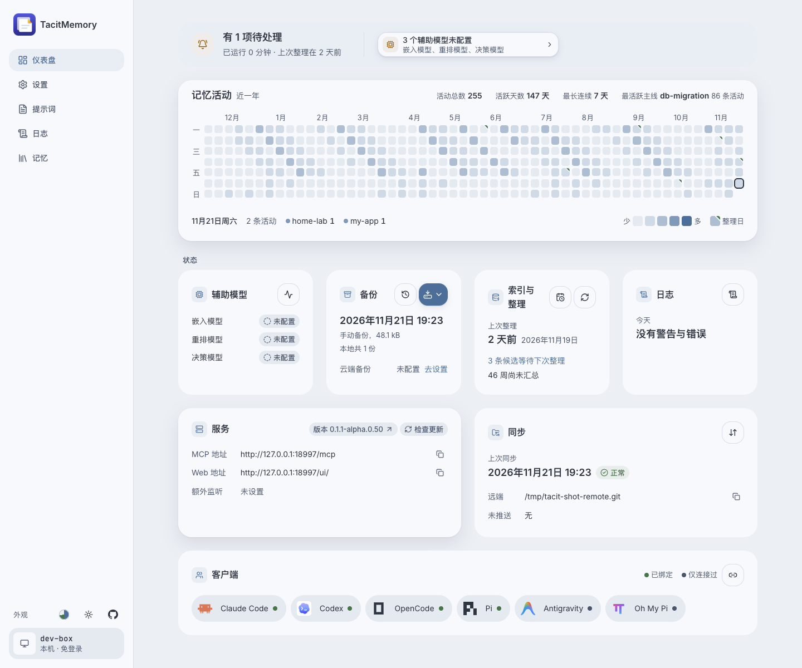
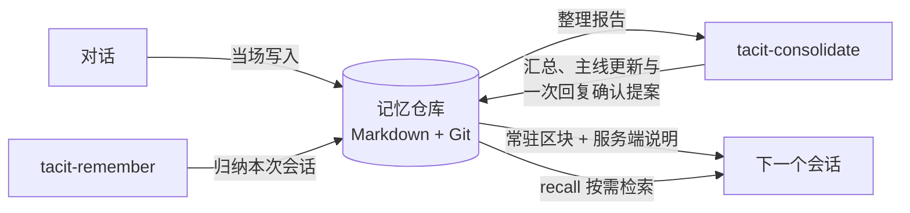
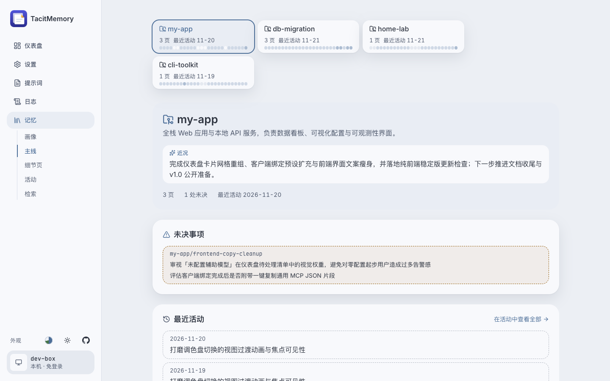
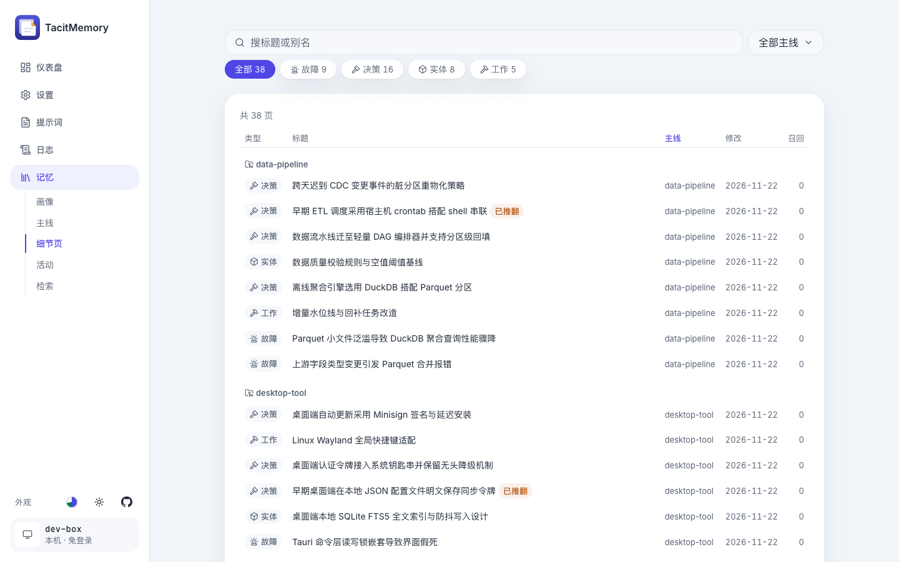
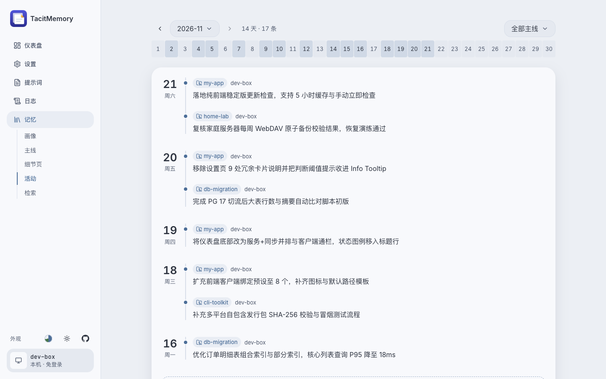
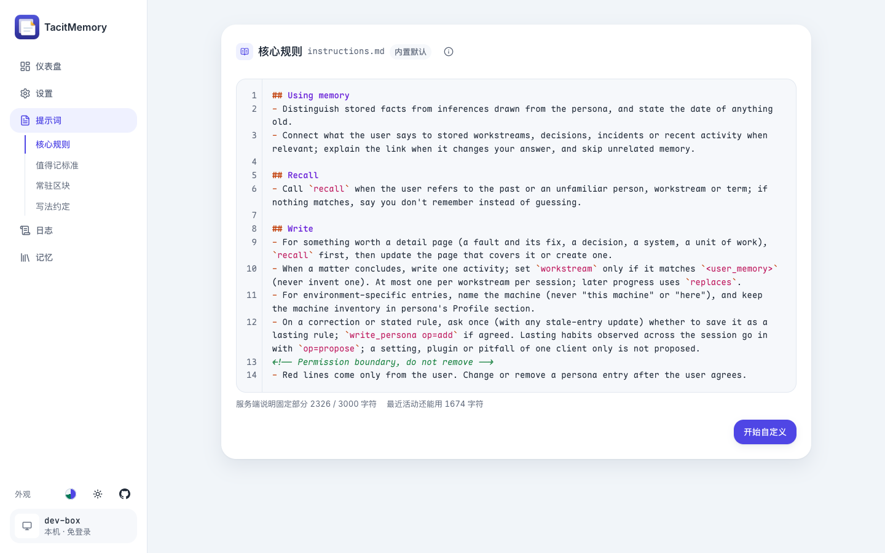

<div align="center">
  
  <h1>TacitMemory</h1>
  <p>跨客户端、跨设备共享的个人白盒记忆系统。所有记忆以纯 Markdown 保存于 Git 仓库，经本地 HTTP MCP 接入任意 AI Agent，支持 macOS、Windows 与 Linux。</p>
  <p>
    <a href="https://github.com/kearril/tacit-memory/releases"></a>
    <a href="LICENSE"></a>
    
    
    
    
  </p>
  <p>
    <a href="README.md">English</a> · <strong>简体中文</strong>
  </p>
</div>



## 为什么做 TacitMemory

**记忆属于用户本身，不应绑定在单一厂商或客户端中。**

越来越多 AI 平台与编码工具内置了记忆功能，但记忆一旦沉淀在厂商云端或客户端私有结构中，在同时使用多个工具或迁移平台时往往难以带走，协作规则、偏好、排错经验与项目背景只能从头说明。

TacitMemory 将个人记忆与具体厂商、客户端解耦：全部内容以纯 Markdown 存放在本地 Git 仓库中，仅依靠上下文文件、Skill 与本地 HTTP MCP 接入任意 Agent，使不同模型与客户端共享同一份白盒、可迁移、可审计的长期记忆。

| 维度 | 厂商 / 客户端内置记忆 | 后台 LLM + 数据库记忆 | **TacitMemory** |
| :--- | :--- | :--- | :--- |
| **存储与可读性** | 云端或客户端私有存储 | 数据库为主存储，难直接编辑 | **白盒 Markdown + Git 历史**，随时可读、可手改、可回溯 |
| **可控与透明度** | 自动写入，过程不易观察 | 后台黑盒抽取与改写 | **人工确认整理提案** + 内置 Web 界面与同管线检索追踪 |
| **归属与开销** | 绑定单一厂商或客户端 | 可跨端，但持续消耗后台生成 Token | **无厂商锁定、跨端共享**，零后台生成式 LLM 成本 |

- **Markdown + Git 白盒设计**：所有记忆人眼可读、任意编辑器可手改、写入自动提交 Git；SQLite 全文与向量索引仅为可随时删除重建的派生缓存，并内置 Web 界面与同管线检索追踪（Recall Trace），每条记忆为何命中或落选全程透明。
- **跨客户端与多设备共享**：适用于 Claude Code、Codex、OpenCode、Pi、Antigravity、DeepSeek Harness 等支持 MCP 的客户端，支持多 Agent 并发读写；多台设备经个人私有 Git 仓库自动同步。
- **零后台生成式 LLM**：理解、归纳与整理提案均由持有完整上下文的主会话 Agent 完成，后台服务不自动改写旧记忆，不产生额外对话 Token 消耗。
- **分层记忆与渐进式披露**：全局画像常驻、领域规则与细节页按需召回、持续事务沉淀为主线简报，在低上下文噪声与跨会话连续性之间取得平衡。
- **轻量部署与优雅降级**：单进程常驻内存约 20 MB，无外部数据库依赖；完整体验面向三类轻量辅助模型协同设计与优化（日常使用强烈建议配齐），未配置时亦会自动降级以支持零模型快速试跑。

## 日常使用

1. **会话开始时自动载入背景**：全局红线、协作规则、个人偏好以及近期活跃项目的背景与进展自动进入上下文，无需重复介绍。
2. **对话过程中按需检索与记录**：Agent 需要历史排错或决策时通过 `recall` 检索；遇到值得沉淀的结论或新规则，按规范写入记忆仓库。
3. **手动触发收尾记录（`tacit-remember`）**：该 Skill 需由用户手动调用（不依赖客户端钩子自动触发）。指令遵循能力较强的模型通常能在日常与长程任务中自主完成记忆写入与复盘；若所用模型可正常检索但写入与复盘主动性不足，可在压缩上下文或结束任务前手动调用 `tacit-remember`，引导其归纳并写入本次会话结论。
4. **手动触发定期整理（`tacit-consolidate`）**：该 Skill 同样需由用户手动调用。定期或在收到整理提醒时运行，Agent 会先自动修正格式、生成周/月汇总并更新主线近况，再将需决策的变更整理为编号清单，由用户一次回复批量确认。
5. **直接浏览与手动编辑**：可通过本地 Web 界面查看或检索记忆，也可使用任意编辑器直接修改 `~/.tacit/memory` 下的 Markdown 文件，服务会监听变更并自动更新索引。

## 安装

运行时仅需本机 `PATH` 中有 **`git`**。以下发行包均为**自包含预编译包，无需预装 .NET 11 运行时或 Bun**（覆盖 `win-x64`、`osx-arm64` 与 `linux-x64`）。

### 方式一：由 AI Agent 自动安装与配置

如果本机已有支持终端命令的 AI Agent，可将下方提示词发给它，由其读取仓库文档完成安装、初始化、后台常驻配置与当前客户端接入：

```text
请阅读 https://github.com/kearril/tacit-memory 的文档，在当前机器上为我安装并初始化 TacitMemory，配置后台常驻运行，并完成你当前客户端的绑定与本地 HTTP MCP 接入。涉及记忆语言选择、辅助模型或多机 Git 同步配置时，先向我确认再执行。
```

### 方式二：包管理器或手动安装

**Homebrew（macOS Apple Silicon / Linux x64）**

```bash
brew install kearril/tap/tacit
# 升级（升级前请先停止 tacit serve）
brew upgrade kearril/tap/tacit
```

**Scoop（Windows x64）**

```powershell
scoop bucket add kearril https://github.com/kearril/scoop-bucket
scoop install tacit
# 升级（升级前请先停止 tacit serve）
scoop update tacit
```

<details>
<summary>手动下载预编译包 / 从源码构建</summary>

**手动下载**：从 [GitHub Releases](https://github.com/kearril/tacit-memory/releases) 下载对应平台发行包（`tacit-<版本>-win-x64.zip`、`tacit-<版本>-osx-arm64.tar.gz`、`tacit-<版本>-linux-x64.tar.gz`），解压至空目录后加入 `PATH` 或建立符号链接：

```bash
mkdir -p <安装目录> && tar -xzf tacit-<版本>-osx-arm64.tar.gz -C <安装目录>
ln -s <安装目录>/tacit ~/.local/bin/tacit
```

**从源码构建**（需要 .NET 11 SDK 与 Bun）：

```bash
dotnet publish src/TacitMemory.Cli -c Release -o <安装目录>
```

该命令生成依赖框架的产物（需预装 ASP.NET Core 11 运行时）。构建自包含发行包或跳过 Web 构建的方式见 [`docs/operations.md`](docs/operations.md)。

</details>

## 快速开始

无需预先部署外部模型，3 步即可跑通基础流程并开始试跑：

1. **初始化配置与记忆仓库**

   ```bash
   tacit init
   ```

   在 `~/.tacit` 下生成 `config.yaml` 与记忆仓库。交互式终端会提示选择记忆语言（`zh` 或 `en`）；脚本环境下请显式传入 `--language zh` 或 `--language en`。

2. **启动常驻服务**

   ```bash
   tacit serve
   ```

   默认前台运行（建议置于独立终端或交由系统服务管理器托管）。启动后在浏览器访问 `http://127.0.0.1:18888/` 即可进入 Web 界面。

3. **绑定客户端并接入 MCP**

   在 Web 界面的 **「设置 → 绑定」** 中完成客户端绑定：可直接选用内置预设（Claude Code、Codex、OpenCode、Pi、Oh My Pi、Antigravity、DeepSeek Harness、Hermes），也可直接填写任意兼容客户端的上下文文件与 Skill 目录路径（命令行环境下亦可通过 `tacit connect` 绑定）。

   随后将本地 HTTP MCP 地址加入客户端配置（具体字段名以各客户端格式为准），新建会话即生效：

   ```json
   {
     "mcpServers": {
       "tacit": {
         "url": "http://127.0.0.1:18888/mcp"
       }
     }
   }
   ```

完成以上步骤即可开始使用；正式长期使用时，强烈建议前往 Web 界面 **「设置 → 模型」** 配齐[三类辅助模型](#辅助模型)以发挥完整检索与判重能力。版本升级后若内置 Skill 有新增或更新，在 Web 界面重新绑定（或重新执行 `tacit connect`）即可刷新链接。

<details>
<summary>进阶配置：多机 Git 同步、备份与定时整理提醒</summary>

**多机 Git 同步**（仅同步记忆仓库；配置、提示词、绑定与备份留在各自机器）：

1. 准备一个**空**私有 Git 仓库（自建裸仓库 `git init --bare` 或代码托管平台的空私有仓，不要初始化 README）。
2. 第一台机器在 Web 界面 **「设置 → 同步」** 填写 `sync.remote`（并为每台机器设置不同的 `machine.name`），执行 `tacit sync` 推送初始历史；之后服务会在写入前后与定时自动拉推。
3. 其他机器运行 `tacit init --remote <仓库地址>` 克隆同一份记忆仓库，再照常绑定客户端与启动服务。

同步采用线性 rebase，并对只追加文件（`recent/*.md`、`candidates.md`）自动启用 `merge=union`；遇冲突或历史分叉时自动暂停同步等待人工处理，不丢失本地数据。详见 [`docs/operations.md`](docs/operations.md)。

**备份与恢复**：每日首次写入后在 `~/.tacit/backups/` 生成本地备份（默认保留 7 份），另支持 `tacit backup` 手动备份与 WebDAV 云端快照；`tacit restore` 恢复前会预览变更并自动创建保险备份。

**定时整理提醒**：服务通过 `tacit consolidation` 与 `GET /api/consolidation` 对外提供「是否需要整理」布尔信号（仪表盘支持一键复制配置指令），便于在支持定时任务的客户端中设置定期巡检。

</details>

<details>
<summary>进阶配置：跨设备访问 Web 界面</summary>

1. 在本机 Web 界面进入 **「设置 → 远程访问」** 设置访问密码。
2. 在同一节填写 **额外监听地址**（如局域网 / 虚拟专网 IP 或 `0.0.0.0`），保存后重启 `tacit serve`。
3. 在其他设备访问 `http://<地址>:<端口>/` 并输入密码登录。

`/mcp` 端点始终仅接受本机回环连接。服务不内置 HTTPS，访问密码与密钥以明文传输，请仅在可信网络（如加密虚拟专网）中开放额外监听。

</details>

---

## 工作原理

### 记忆分层与渐进式披露

| 记忆层 | 内容 | 进入上下文的方式 |
| :--- | :--- | :--- |
| **画像（Persona）** | 红线、协作规则、偏好与档案（分全局、领域、主线三种作用域） | 全局条目与领域索引常驻；领域规则与主线约定按需读取 |
| **主线（Workstreams）** | 持续进行的事务（项目、运维等），含稳定背景与近期摘要 | 随会话常驻（近 28 天活跃的主线附近期摘要）；进入主线时可一次读取全景简报 |
| **活动记录（Activities）** | 一行一条的会话结论（按月归档），整理时生成周/月汇总 | 最近 7 天随 MCP 服务端说明下发，更早记录按需检索 |
| **细节页（Pages）** | 按主题组织的 Markdown 页面（`incident`、`decision`、`entity`、`work`） | 由 Agent 通过 `recall` 按需检索，支持 `supersedes` 演进关系 |

### 工作流程



### 接口与安全边界

- **4 个 MCP 工具**：`recall`（混合检索、读整页、主线简报与画像/规则读取）、`write_page`（按小节创建或更新细节页）、`write_recent`（写入或改写当日活动结论）、`write_persona`（写入画像条目或提交候选）。
- **1 个 MCP 资源**：`tacit://consolidation-report`，整理时现场生成两段式报告，不占工具槽位，也不会被模型擅自调用。
- **3 个内置 Skill**：`tacit-memory` 由 Agent 在写入前按需读取；`tacit-remember` 与 `tacit-consolidate` 均由用户手动调用触发（不挂载客户端钩子）。
- **本地安全边界**：写入前在本地通过正则拦截常见密钥与凭据（不向外部模型外发原文），`/mcp` 端点严格仅监听本机回环地址。

## 辅助模型

TacitMemory 的混合检索、精排与写入/整理判重流程，均围绕**嵌入、重排与决策三类轻量级 HTTP 辅助模型配齐**的场景设计与优化。系统允许三者全部留空以支持零配置试跑，并在模型故障时自动降级、不阻塞写入；但**日常正式使用强烈建议配齐三者**，以获得完整的语义召回精度、精排效果与自动判重/冲突检测能力。

| 模型 | 职责 | 支持协议与提供方 | 缺省或不可用时的降级 |
| :--- | :--- | :--- | :--- |
| **嵌入模型（Embedding）** | 生成文本向量，用于语义检索与判断前近邻筛选 | **OpenAI Embeddings**（兼容 OpenAI、Ollama、vLLM、`llama.cpp`、Cloudflare Workers AI 等） | 退回纯 SQLite FTS5 全文检索（支持中文） |
| **重排模型（Reranker）** | 对融合后的检索候选精排与低分过滤 | **Cohere / Jina Rerank**；内置 `provider: cloudflare` 适配 Cloudflare Workers AI | 直接按 RRF 融合排序返回 |
| **决策模型（Decision）** | 回答四类结构化选择题（重复页、同日同主题、同一偏好、画像冲突），仅输出选项概率、不生成自由文本，按双阈值分为「确定 / 不确定 / 否定」 | **System One** 协议（如 TypeSafe `jev-latest`）；内置 `provider: cloudflare` 适配 Cloudflare Workers AI | 所有判断按「不确定」放行，留待整理阶段复核 |

三类模型可按自身环境自由对接本地推理服务或云端兼容 API。在 Web 界面 **「设置 → 模型」** 中填写完整请求地址（`url` 原样请求、不自动拼接路径）与密钥，保存后点击卡片右上角 **探测** 验证连通性；先试跑、后续补配嵌入模型时，执行一次 `tacit reindex` 即可为历史记忆补全向量。

<details>
<summary>参考选型与阈值说明（含零本地部署方案与作者自用配置）</summary>

以下仅为参考，不限定具体提供方或部署方式：

- **零本地部署（Cloudflare Workers AI）**：可通过内置的 `provider: cloudflare` 适配一站配齐三类模型（Cloudflare Workers AI 的 Free 方案包含每日免费额度，个人日常使用通常足够，具体以 Cloudflare 官方政策为准）——嵌入 `@cf/baai/bge-m3`（OpenAI 兼容端点）、重排 `@cf/baai/bge-reranker-base`（`provider: cloudflare`）、决策 `@cf/cloudflare/clef` 或 `@cf/cloudflare/clef-flash`（`provider: cloudflare`）。
- **作者自用参考（本地检索 + 云端决策）**：本地经 `llama.cpp` / vLLM 运行 **`Qwen3-Embedding`**（`0.6B` / `4B`）与 **`Qwen3-Reranker`**（`0.6B` / `4B`），兼顾低延迟与检索文本不出本机；决策模型接入云端 **TypeSafe `jev-latest`**。
- **决策阈值说明**：内置默认判断阈值基于 TypeSafe `jev-latest` 标定；若换用其他决策模型（如 Cloudflare Clef 系列），请参阅 [`docs/configuration.md`](docs/configuration.md) 按需核对阈值。

</details>

## 设计取舍

以下三点是为换取「白盒、可控、跨端通用与零后台开销」做出的刻意取舍，选用前值得了解：

- **记忆质量取决于主会话模型**：服务本身不运行后台生成式 LLM，何时调用 `recall`、记录什么内容以及整理提案的质量，均取决于当前对话所用模型的指令遵循能力。实际使用中，指令遵循能力较强的模型通常无需刻意引导即可自主检索，并在长程任务中持续完成记录与复盘；主动性较弱的模型往往能正常检索已有记忆，但在写入与复盘环节容易遗漏，需配合手动调用 `tacit-remember` 引导收尾。作为回报，系统不产生额外后台 Token 消耗，旧记忆也不会在后台被擅自改写。
- **需要轻量人工配合，而非全自动黑盒**：不接入客户端钩子做会话后静默抽取，`tacit-remember` 与 `tacit-consolidate` 均需手动触发；每隔一段时间花一两分钟批量回复一次整理提案清单，换来的是长期记忆零幻觉漂移，每项改动均经人工确认。
- **多端共享需注意作用域边界**：尽管系统提供显式机器标识（`on <机器名>`）与全局 / 领域 / 主线作用域隔离，日常写入与整理时仍需区分「通用个人习惯」与「单机 / 单客户端细节」，避免跨环境污染。

如果将个人记忆视为一份可迁移、可审计的长期个人资产，这些投入就是自然代价——有价值的资产需要维护，不会凭空得来，正如花园若从不修剪便难以维持整洁。

## 界面一览

内置的 **检索追踪（Recall Trace）** 使用与 Agent 一致的管线执行查询，可逐阶段对比全文、向量、RRF 融合、演进图扩展、精排与调分门控结果，直观定位每条记忆命中或落选的原因：


<details>
<summary>展开查看更多界面截图（画像、主线、细节页、活动时间线、提示词、设置）</summary>

| 画像（Persona） | 主线简报（Workstreams） |
| :---: | :---: |
|  |  |

| 细节页（Pages） | 活动时间线（Activities） |
| :---: | :---: |
|  |  |

| 提示词编辑器（Prompts） | 可视化设置（Settings） |
| :---: | :---: |
|  |  |

</details>

## 性能与基准测试

本地索引与检索管线在单进程内完成：SQLite FTS5 全文检索与零拷贝 SIMD 余弦向量扫描（单次查询内存分配保持 `O(K)` 恒定）经 RRF 融合后，叠加基于 `supersedes` / `related` 的有界一跳演进图扩展、重排精排、白盒状态/类型/时序调分与两层自适应门控。

Apple Silicon 参考实测数据（Release 构建、`1024` 维向量，不含外部模型推理耗时）：

| 检索单元数 | 冷建同步 | 增量同步 | FTS5 P50 | Vector P50 / 分配 | End-to-End P50 |
| ---: | ---: | ---: | ---: | ---: | ---: |
| 500 | 53.6 ms | 2.1 ms | 0.17 ms | 0.50 ms / 33.1 KB | 1.42 ms |
| 2,000 | 95.6 ms | 5.4 ms | 0.23 ms | 1.60 ms / 33.2 KB | 2.64 ms |
| 10,000 | 544.5 ms | 34.6 ms | 0.74 ms | 7.66 ms / 33.4 KB | 9.95 ms |

仓库内置可复现的 `perf` 与 `recall` 基准工具（`benchmarks/TacitMemory.Benchmarks`），自带 38 页 / 92 查询脱敏语料与本地模型缓存代理，可用于横评嵌入/重排模型或测试私有语料库。在默认配置与本地 `Qwen3-Embedding-0.6B` + `Qwen3-Reranker-0.6B` 组合下，92 条查询实测达到 **Recall@5 100.0%**、**Hit@1 93.3%**、**All@5 100.0%**、**MRR 0.967** 与 **52.9% 负例拒答率**。详细命令与分类参考见 [`docs/benchmarks.md`](docs/benchmarks.md)。

## 文档导航

- [`docs/design.md`](docs/design.md) — 系统行为、记忆规则、Web 界面与安全边界
- [`docs/decisions.md`](docs/decisions.md) — 设计决策、权衡依据与未选方案
- [`docs/configuration.md`](docs/configuration.md) — 环境变量、`config.yaml` 与提示词自定义
- [`docs/memory-files.md`](docs/memory-files.md) — 记忆仓库目录结构与 Markdown 格式
- [`docs/operations.md`](docs/operations.md) — 备份恢复、Git 同步、排障与发布流程
- [`docs/development.md`](docs/development.md) — 代码架构、测试接缝与本地构建
- [`docs/benchmarks.md`](docs/benchmarks.md) — 检索召回与索引性能基准指南
- [`CHANGELOG.md`](CHANGELOG.md) — 版本更新记录

## 许可与反馈

采用 [Apache License 2.0](LICENSE) 开源许可发布。发行包中附带的第三方许可声明见包内 `THIRD-PARTY-NOTICES.txt`。欢迎通过 [GitHub Issues](https://github.com/kearril/tacit-memory/issues) 提交问题、建议或使用反馈。
