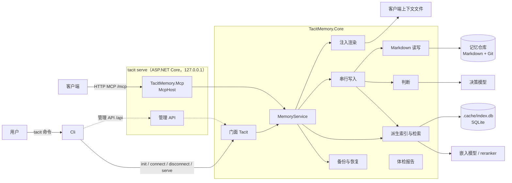

# TacitMemory 架构

本文档记录代码如何组织：程序集边界、模块分工、数据流与外部依赖。系统行为、接口与规则见 `docs/design.md`，术语见 `GLOSSARY.md`。代码结构变化时同步更新。

本文描述 v1 的目标结构。各表的"状态"列标明是否已实现：**已实现**、**部分**（已实现的部分写在括号里）、**计划**。

## 1. 总览

实线为已实现的部分，虚线为计划中的部分。

## 2. 程序集

| 程序集 | 职责 | 依赖 |
| :--- | :--- | :--- |
| `TacitMemory.Core` | 全部记忆规则（模块见第 3 节）。只公开门面 `Tacit`、常驻服务的运行状态 `MemoryService` 与契约类型，其余为 `internal` | 无内部依赖 |
| `TacitMemory.Mcp` | MCP 主机 `McpHost`：在 `127.0.0.1` 上挂载 `/mcp`，把门面操作映射为 MCP 工具、prompt 与服务端说明，不含业务规则 | `Core` |
| `TacitMemory.Cli` | `tacit` 命令（可执行文件名 `tacit`）：`init`、`connect`、`disconnect` 直接调用门面；`serve` 打开 `MemoryService` 并启动 `McpHost`；运维命令经管理 API 调用服务（计划） | `Core`、`Mcp` |

## 3. Core 内部模块

| 模块 | 职责 | 状态 |
| :--- | :--- | :--- |
| 门面 | 对外的唯一入口 `Tacit`；`OpenService` 返回 `MemoryService`，持有配置、记忆工具、服务端说明缓存与文件监听 | 部分（初始化、加载配置、绑定与解绑、渲染常驻区块、打开常驻服务、读取、新建与修改细节页） |
| 初始化 | 生成 `config.yaml` 与 `rules.md` 模板，创建记忆仓库骨架 | 已实现 |
| 配置 | 逐项读取并校验 `config.yaml`，一次报告全部出错的键路径；读取 `rules.md`，缺失时按记忆语言重新生成 | 已实现 |
| 串行写入 | 所有写入排入单一队列；每次写入：校验 → 判断 → 改文件 → 同步索引 → Git 提交 → 必要时重渲染常驻区块 | 部分（细节页：队列、校验、凭据检测、重复页判断、改文件、同步索引、提交；近期活动：队列、校验、凭据检测、改文件、提交，索引同步尚未接入） |
| 近期活动 | 按日写入 `recent/YYYY-MM.md`：定位当日标题、插入条目并保留其余字节、来源注释、按文件内顺序计算短码 | 部分（`add_activity`：写入、短码、提交） |
| Markdown 读写 | 解析各文件格式（识别所有语言的结构词）、按行定位修改、计算短码、记录格式问题 | 部分（解析 `persona.md`；细节页的页头与小节、小节短码） |
| 派生索引与检索 | SQLite FTS5 与 `vec0` 建表与增量同步；索引按来源组织（来源为被索引的文件，单元携带类型、项目与日期）；中文两字切分；RRF 合并；调用 reranker；索引版本校验与重建 | 部分（FTS5 与 `vec0`、来源与单元组织、RRF 合并、reranker 精排与分数下限、按哈希增量同步、表结构版本不符或文件损坏时重建、嵌入模型名或向量长度变化时重做向量） |
| 判断 | 各判断的问题模板（英文）与近邻筛选；三档阈值与内置默认值；凭据正则；降级 | 部分（重复页判断：同项目嵌入近邻、选择题、三档，决策模型或嵌入模型不可用时放行并注明；凭据检测：只用本地正则，命中即拒绝，不调用决策模型） |
| 决策模型接口 | 与模型无关的三种题型（选择、打分、真伪）；TypeSafe 适配器 | 已实现（Jev `/systemone`；密钥取自 `apiKey` 或 `apiKeyEnv`，环境变量缺失视为不可用） |
| 辅助模型客户端 | 以 `HttpClient` 调用三个模型；记录每个模型是否可用，失败后 30 秒内不再调用，避免每次请求都等一次超时 | 已实现 |
| 注入渲染 | 常驻区块渲染与标记校验；按段落组装服务端说明并执行长度上限 | 部分（常驻区块；服务端说明的开场、记忆规则、语言规范、值得记标准、状态提示、已有项目） |
| 客户端适配 | 定位上下文文件、注册与注销 MCP、`bindings.json` 读写 | 部分（omp） |
| 体检报告 | 现场计算体检报告各项 | 计划 |
| 备份与恢复 | zip 打包与解包、保留份数、远端推送；恢复时暂停写入队列 | 部分（每日首次写入后自动备份、保留份数、明文密钥提示） |
| Git | 经 `SimpleExec` 调用 `git` 命令行：初始化、按文件提交、查询提交时间、推送 | 部分（初始化、按文件提交） |
| 文件同步 | 运行时以 `FileSystemWatcher` 监听记忆仓库；启动时按哈希增量同步索引，忽略服务自身写入引起的事件 | 部分（监听 `persona.md` 与 `pages/`，另监听 `TACIT_HOME` 下的 `rules.md`；页面文件变化后去抖并按哈希同步索引；写入后立即同步该页，之后的监听事件因哈希相同不再处理） |
| 本地化 | 面向人的短文本与结构词：每一项以 `Localized(Zh, En)` 一并定义，缺一种写法即无法编译；面向 Agent 的英文文本只有一份 | 已实现 |

## 4. 数据流

### 写入（部分：细节页与近期活动已走通，画像计划）

1. MCP 工具调用进入门面，按 `op` 校验参数，排入串行队列；
2. 凭据检测；校验上限、必填线索、短码；
3. 需要时调用嵌入模型取近邻，再由决策模型判断；
4. 按行修改 Markdown 文件，更新受影响的索引条目；
5. 用 `git` 只提交本次写入的文件；
6. 画像变化时重新渲染常驻区块；当天首次写入后触发自动备份。

调用 `git` 一律加 `-c core.quotepath=off` 并以 UTF-8 读取输出，避免中文路径被转义或乱码。

### 检索（部分）

1. 按单元自身的项目与日期筛选（普通 SQL）；单元挂在来源（被索引的文件，当前为细节页）下，项目与日期逐单元保存；
2. 全文：FTS5（unicode61 分词），中文在写入索引与查询前统一切成相邻两字一组；查询中的每个两字组与每个非中文词各为一项，任一项命中即可，按 BM25 排序；查询只含单个汉字时退回子串匹配；
3. 向量：`vec0`（余弦距离），单位为小节、页面的 `title + aliases`、活动条目；带筛选时在筛选后的单元上按距离排序。缺向量的单元在后台按批补齐：启动与监听同步后、每次写入后、以及模型恢复后的第一次检索时；
4. 两路各取候选，RRF 合并后交 reranker，按阈值过滤并截取（数量见 `docs/design.md` 第 7 节）。

### 注入

- `MemoryService` 生成服务端说明后缓存。项目目录变化或 `rules.md` 重新载入时缓存失效；每次取用时比对状态（不可用的模型、被跳过的文件），不同则重新生成。无状态模式下 SDK 每个请求都要求给出服务端说明，状态相同时直接返回缓存。
- `persona.md` 变化后（文件监听事件去抖 300 ms），注入渲染重写所有已绑定文件中的常驻区块。渲染彼此串行；失败只在控制台提示，不中断服务。

## 5. 进程与传输

- `serve` 进程中的 ASP.NET Core 主机只监听 `127.0.0.1:<port>`，不做鉴权。
- MCP 端点挂载于 `/mcp`，使用 SDK 的无状态模式（`HttpServerSessionMode.Stateless`）。工具由 `MemoryTools` 声明，参数与标注随工具定义，调用直接转交 `MemoryService`。没有 prompt 时仍回应空列表：omp 不看服务器声明的能力，照样请求，请求失败就丢弃这个服务器。端口被占用时 `McpHost` 不启动，由 CLI 报告。
- 管理 API 挂载于 `/api`，供 `status`、`reindex`、`backup`、`restore` 使用，将来的 Web UI 也走这里（计划）。

## 6. 外部依赖

| 用途 | 选用 | 状态 |
| :--- | :--- | :--- |
| HTTP MCP 服务 | `ModelContextProtocol.AspNetCore` | 已引入 |
| YAML（页头、配置） | `YamlDotNet`（表示模型）；`config.yaml` 由 Core 逐项读取，不接入框架配置系统 | 已引入 |
| CLI | `ConsoleAppFramework` | 已引入 |
| 调用 `git` | `SimpleExec`（只用 `ReadAsync`：不回显命令，可指定编码与取消，非零退出码抛出带输出的异常） | 已引入 |
| 索引驱动 | `Microsoft.Data.Sqlite`（关闭连接池，以便删除重建索引文件） | 已引入 |
| 向量 | `sqlite-vec` 官方发布的 Windows x64 可加载扩展 `vec0.dll`（v0.1.9），连同上游 LICENSE 存于仓库 `lib/sqlite-vec/`，构建时复制到输出目录；每次加载前校验代码中记录的 SHA-256，不符则拒绝启动；不使用 NuGet 上的第三方包 | 已引入 |
| 查询与映射 | `Dapper` | 已引入 |
| 嵌入 | `HttpClient`，调用 OpenAI 兼容的 `/embeddings`；请求与响应只有几个字段，不为此引入 SDK | 已引入 |
| reranker | `HttpClient` 类型化客户端，调用 Cohere/Jina 兼容的 `/v1/rerank` | 已引入 |
| 决策模型 | `HttpClient`，调用 TypeSafe 的 `/systemone` | 已引入 |
| 重试与超时 | 不重试：调用失败即按降级处理，冷却后再试；每次调用设超时 | 已实现 |

依赖原则：一个依赖能解决实际问题或简化逻辑就引入，避开停更或附带额外条款的包。不引入中文分词库、表结构迁移库与 EF Core（与 FTS5、`vec0` 虚拟表不合）。Markdown 只按行识别 `##` 小节与代码围栏，不引入 Markdown 解析库：按行修改要求原样保留其余字节，语法树帮不上。版本以各项目文件为准；尚未引入的依赖在引入时锁定版本。
