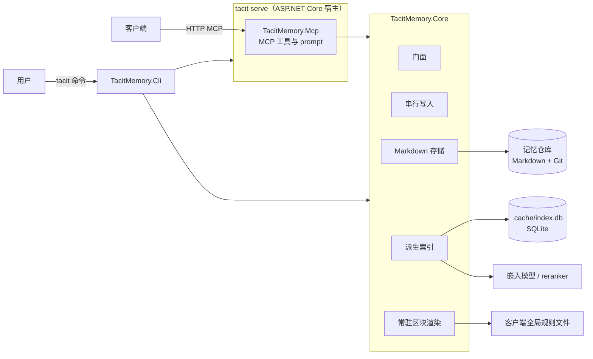

# TacitMemory 架构

本文档记录代码如何组织：程序集边界、模块分工、数据流与外部依赖。系统行为与规则见 `docs/design.md`，术语见 `GLOSSARY.md`。代码结构变化时同步更新。当前尚无实现代码，以下为初版目标结构。

## 1. 总览

## 2. 程序集

| 程序集 | 职责 | 依赖 |
| :--- | :--- | :--- |
| `TacitMemory.Core` | 全部记忆规则：存储读写、写入校验与上限、索引与检索、常驻区块渲染、Git 提交、文件监听。仅公开门面接口与契约类型，其余为 `internal` | 无内部依赖 |
| `TacitMemory.Mcp` | 将门面操作映射为 MCP 工具与 prompt，不含业务规则 | `Core` |
| `TacitMemory.Cli` | `tacit` 命令：`serve`（启动宿主）、`connect`（绑定客户端）、`reindex`、`status` | `Core`、`Mcp` |

## 3. 数据流

### 写入

1. MCP 工具调用进入门面，写入请求排入串行队列；
2. 校验必填线索、上限、候选去重与拒绝列表；
3. 写 Markdown 文件，更新受影响的索引条目；
4. 用 `git` 只提交本次写入的文件。调用一律加 `-c core.quotepath=off` 并以 UTF-8 读取输出，避免中文路径被转义或乱码；
5. 若影响常驻内容，重新渲染各已绑定客户端的常驻区块。

### 检索

1. 按所属项目与日期筛选（普通 SQL）；
2. 全文：SQLite FTS5（unicode61 分词）。中文在写入索引与查询前统一切成相邻两字一组，英文单词与文件名保持完整；单字查询退回 `LIKE`；
3. 向量：sqlite-vec `vec0`（余弦距离），`title + aliases` 一个向量，正文分段各一个向量；
4. 合并两路结果，调用 reranker 重排。

### 文件同步

- 启动时按文件哈希比对，增量重建索引；
- 运行时由 `FileSystemWatcher` 监听记忆仓库，文件变化即重建对应索引并重新渲染常驻区块。

### 索引重建

索引记录表结构版本、嵌入模型名称与向量维度；任一与当前配置不一致即删除并从 Markdown 全量重建。不使用表结构迁移。

## 4. 外部依赖

| 用途 | 选用 |
| :--- | :--- |
| 索引驱动 | `Microsoft.Data.Sqlite` |
| 向量 | `sqlite-vec` 官方发布的 Windows x64 可加载扩展 `vec0.dll`（v0.1.9），随程序打包，锁定版本并校验 SHA-256；不使用 NuGet 上的第三方包 |
| 查询与映射 | `Dapper` |
| HTTP MCP 服务 | `ModelContextProtocol.AspNetCore` |
| Markdown 小节 | `Markdig` |
| YAML（页头、配置） | `YamlDotNet`；`config.yaml` 由自写的配置提供程序（继承 `FileConfigurationProvider`）接入框架配置系统 |
| CLI | `ConsoleAppFramework` |
| 调用 `git` | `SimpleExec`（只用 `ReadAsync`：不回显命令，可指定编码与取消，非零退出码抛出带输出的异常） |
| 嵌入 | `Microsoft.Extensions.AI` + OpenAI 适配包，调用 OpenAI 兼容的 `/v1/embeddings` |
| reranker | `HttpClient` 类型化客户端，调用 Cohere/Jina 兼容的 `/v1/rerank` |
| 重试与超时 | `Microsoft.Extensions.Http.Resilience` |

依赖原则：一个依赖能解决实际问题或简化逻辑就引入。不引入中文分词库、表结构迁移库与 EF Core（与 FTS5、`vec0` 虚拟表不合）。具体版本在建项目时锁定。
