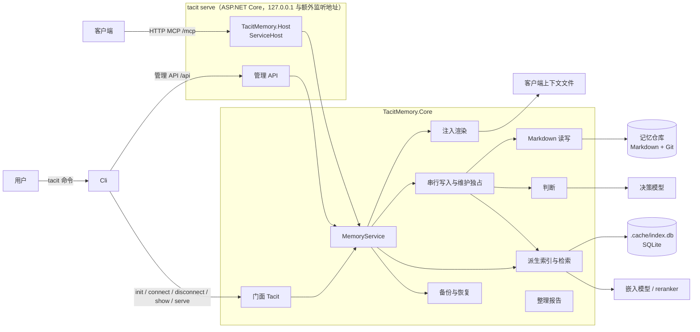

# TacitMemory 架构

本文档记录代码如何组织：程序集边界、模块分工、数据流与外部依赖。系统行为与规则见 `docs/design.md`，对外接口与配置项见 `docs/reference/`，术语见 `GLOSSARY.md`。代码结构变化时同步更新。

本文描述 v1 的目标结构。各表的"状态"列标明是否已实现：**已实现**、**部分**（尚未实现的部分写在括号里）、**计划**。

## 1. 总览

图中所有连线均为已实现的调用关系。

## 2. 程序集

| 程序集 | 职责 | 依赖 |
| :--- | :--- | :--- |
| `TacitMemory.Core` | 全部记忆规则（模块见第 3 节）。只公开门面 `Tacit`、常驻服务的运行状态 `MemoryService`、访问控制 `AccessControl` 与契约类型，其余为 `internal` | 无内部依赖 |
| `TacitMemory.Host` | 承载 HTTP 入口的程序集，内部分 `Mcp/`（工具、资源、工具目录）、`Api/`（管理 API 及其防护）与 `Web/`（`/ui` 的静态文件与 `/` 的跳转）三块。入口 `ServiceHost` 在 `127.0.0.1` 与 `server.host` 给出的额外地址上挂载 `/mcp` 与管理 API `/api`，把 `MemoryService` 的操作映射为 MCP 工具、资源（`tacit://consolidation-report`）与服务端说明（对外接口见 `docs/reference/mcp.md`）。按连接来源区分本机与其他设备的判断在 `ServiceHost`，管理 API 的防护、会话与访问密码的判定在 `ManagementApi`（规则见 `docs/reference/api.md` 第 2 节）；未知参数名交给 Core（机制见第 5 节），不含业务规则。工具说明中的上限由 `ToolCatalog` 按 `MemoryService` 已加载的 `LimitsConfig` 填入，`show tools` 与服务下发共用同一份说明 | `Core` |
| `TacitMemory.Cli` | `tacit` 命令（可执行文件名 `tacit`）。入口 `CommandLine.RunAsync` 接收 `TacitOptions`、`CliConsole`（stdout、stderr、stdin 的读写器、三个终端标志与 `NO_COLOR` 设置）与参数；生产入口 `Program.cs` 是唯一从进程与环境读取的地方，命令只经 `CliConsole` 读写控制台，`ConsoleApp.Log`、`LogError` 指向 stdout 与 stderr。输出美化每一路各自判断：该路是终端且未设 `NO_COLOR` 时，由 `StyledOutput` 经 Spectre.Console 排版上色（`status`、`restore` 预览、`connect` 端点，以及 `reindex`、`backup --remote`、`restore` 执行时的等待转圈），否则走原有的纯文本代码路径。所有命令经 `Commands` 的 `Execute` 执行，映射为退出码：2 用法错误，3 配置无效，4 服务未运行或端口被他人占用，1 其他失败，错误只写 stderr。`init`、`connect`、`disconnect`、`show` 直接调用门面；`show tools` 先经门面 `LoadConfig` 严格加载配置（无效时退出码 3），再经 `TacitMemory.Host` 的 `ToolCatalog.Describe(limits)` 读取工具定义，交给门面 `ShowTools(config, tools)` 标注输出；`serve` 打开 `MemoryService`、启动 `ServiceHost`，并把终端输出同时写入 `logs/`；`status` 经 `ManagementApiClient` 调用管理 API，服务未运行时由门面 `OfflineStatus` 给出离线报告，`config.yaml` 无法加载时先经 `ReadLooseSettings` 宽松读取端口，再由 `InvalidConfigStatus` 给出报告；`reindex`、`backup`、`restore` 经同一个 `ManagementApiClient` 调用管理 API（服务未运行时提示先执行 `tacit serve`，退出码 4） | `Core`、`Host` |

`tacit probe` 经门面 `LoadConfigFile` 严格加载配置（不要求记忆仓库已初始化），再经门面 `ProbeAsync` 探测；门面返回的 `ProbeReport` 已含按记忆语言排好的报告行，CLI 原样打印，颜色由 `StyledOutput` 按终端规则施加，退出码由 `Commands` 按结果算出。它不经 `Commands` 的服务路径，不需要服务运行。

## 3. Core 内部模块

| 模块 | 职责 | 状态 |
| :--- | :--- | :--- |
| 门面 | 对外的唯一入口 `Tacit`：`GenerateSkills` 生成全部 skill，不需要运行中的服务；`OpenService` 返回 `MemoryService`，持有配置、记忆工具、服务端说明缓存、文件监听与访问控制，整理报告的入口是 `MemoryService.ConsolidationReportAsync`；`OpenAccess` 返回独立的 `AccessControl`，不需要运行中的服务，供测试与不经常驻服务的调用方使用（常驻服务内的访问经 `MemoryService.Access`） | 已实现 |
| 访问 | `Access/AccessControl`：访问密码与会话。`access.json`（PBKDF2-SHA256 的哈希与会话签名密钥，不属于配置，不进入备份）的读写与损坏时的处理；会话为 HMAC-SHA256 签名的 Cookie 值，服务端不存清单；按对端地址的登录限速，计数表有上限，PBKDF2 的计算在锁外，检查暂停、计算与计数之间不让并发请求绕过计数。规则见 `docs/reference/api.md` 第 2 节 | 已实现 |
| 初始化 | 生成 `config.yaml` 与 `prompts/rules.md` 模板，创建记忆仓库骨架 | 已实现 |
| 配置 | 逐项读取并校验 `config.yaml`，一次报告全部出错的键路径；三个模型各为一个可空的 `ModelConfig`（`provider`、`url`、`model`、可选的 `apiKey`），`provider` 缺省为通用协议（`ModelProvider.Generic`），`cloudflare` 不区分大小写（`ModelProvider.Cloudflare`），其他值报错并列出可用取值；`null` 即未配置（`models` 段或某个映射缺失，不报错；映射存在而 `url` 或 `model` 为空则报错），`url` 原样保存；密钥（`models.{embedding,reranker,decision}.apiKey`、`backup.webdav.password`）在加载时解析，环境变量优先，结果保存值与来源；读取并校验 `prompts/` 下的提示词文档（规则见 `docs/reference/configuration.md`「提示词文档」）；校验服务端说明的固定部分长度（见 `docs/design.md` 第 8 节） | 已实现 |
| 串行写入 | 写入与后台任务经 `MaintenanceGate` 的写入模式依次进行（同一时间一个），读取经读取模式与之共享；每次写入：校验 → 凭据检测 → 判断 → 改文件 → Git 提交 → 同步索引 → 必要时补齐向量、重渲染常驻区块、自动备份 | 已实现 |
| 维护操作 | `MemoryService.RunMaintenanceAsync`：独占 `MaintenanceGate`，先等在途的向量补齐、判断与自动备份结束，再执行；期间其他读写与后台任务排队（范围见 `docs/design.md` 第 12 节「服务运行」）。`reindex`（`ReindexAsync`）与 `restore`（`RestoreAsync`）都是维护操作；恢复的校验在 `Backup/RestoreArchive`，换入与回退在 `Backup/RestoreInstall`（`Maintenance/MoveJournal` 记录每次移动并逆序撤销）。 | 已实现 |
| 主线文件 | `Workstreams/WorkstreamFile`：解析 `workstreams.md`，给出已成立的主线（名字、背景说明、近期摘要）与格式问题；常驻区块与主线简报读取它 | 已实现 |
| 近期活动 | 写入活动（`text`、`replaces`）：按日定位标题并保留其余字节、计算活动短码；回复只附新短码。主线不经写入路径，由整理直接编辑 `workstreams.md` | 已实现 |
| 画像写入 | `write_persona` 的四个操作：参数按 `op` 校验，经校验与判断（画像冲突、同一偏好）后按行修改画像或候选文件，经串行队列写入并提交；画像变化时重渲染常驻区块。行为见 `docs/design.md` 第 6 节 | 已实现 |
| 细节页写入 | `write_page` 的四个操作（`create`、`upsert_section`、`delete_section`、`update_header`）：参数按 `op` 校验，凭据检测，小节以短码定位，只改写本次文件并提交，写入后同步该页的索引 | 已实现 |
| Markdown 读写 | 解析各文件格式（识别所有语言的结构词）、按行定位修改、计算短码；解析时同时返回格式问题（文件、位置、说明），由整理报告生成时当场使用；解析 `candidates.md` 的候选与拒绝列表及其出现记录，并按行追加出现记录 | 已实现 |
| 画像读取 | `recall` 的 `kind=persona` 与 `rules`：`PersonaReading` 渲染整份画像或领域规则，每条附短码，原话注释不输出；不经派生索引、不计使用统计。行为见 `docs/design.md` 第 7 节 | 已实现 |
| 派生索引与检索 | SQLite FTS5 与 `vec0` 建表与增量同步；索引按来源（细节页、活动记录、画像与候选文件）组织，单元携带类型、主线与日期；画像每条与每个候选各为一个单元，供判断按来源取嵌入近邻（写入前后与手动编辑后同步），检索永不返回；中文两字切分；RRF 合并；reranker 精排；索引版本校验；`Rebuild` 删除并重建索引文件，全文、单元、向量与判断缓存一并清空，之后按文件重新同步；`judgment_cache` 表保存整理判断的概率，键为提问内容的哈希，三档在读取时按阈值计算；小节保存内容哈希与最后变化日期，单元保存返回次数与最近返回日期（使用统计，见 `docs/design.md` 第 7 节） | 已实现 |
| 主线简报 | `Retrieval/WorkstreamBrief`：`recall` 只给 `workstream` 时由 `RecallTool` 交给它。读取该主线的页面文件、主线作用域的画像与月文件，组装主线名、主线约定、未决事项、页目录（按类型分组）、最近 3 条活动与最近一次周汇总；超出 `limits.brief` 时截断页目录；经索引同步页面并计入使用统计，不经全文与向量检索。行为见 `docs/design.md` 第 7 节 | 已实现 |
| 汇总 | `Recent/Summary`、`SummaryCalendar`、`SummaryMaterial`：汇总行的解析与写法（周按 ISO 周、月按自然月）、已结束且未汇总的周期的判定，以及整理报告中的汇总材料。服务不写汇总，汇总由整理时的主会话直接编辑活动记录文件；汇总节不参与活动的短码与同主题判断 | 已实现 |
| 活动统计 | `Recent/ActivityCounts`：管理 API `/api/activity` 的来源，供仪表盘的热力图使用。窗口为含本周在内的 53 周，只读窗口涉及的月文件，按日统计活动条数（按主线标签分开，没有标签的计为未归属）；整理日取窗口内的 `consolidate:` 提交，与状态报告的上次整理同一判定。不是 UTF-8 或读不了的月文件被跳过并点名，历史读不了时整理日为空并注明，都不使调用失败；只读，不取锁、不写文件 | 已实现 |
| 判断 | 各判断的问题模板（英文）与候选筛选；三档阈值与内置默认值；凭据正则；降级 | 已实现 |
| 决策模型接口 | 只含选择题（返回各选项概率）；System One 协议的实现 `SystemOneDecisionModel`，请求发往配置的完整 URL（TypeSafe 的原生决策接口即其一个服务），密钥取自 `models.decision.apiKey` 或环境变量 `TACIT_DECISION_API_KEY`（环境变量优先），没有密钥时不带认证头；`provider: cloudflare` 时请求体相同，只在读取响应时先取 `result` | 已实现 |
| 辅助模型客户端 | 以 `HttpClient` 调用三个模型，三者共用 `ModelClient` 的请求内重试与冷却（数值与判定规则见 `docs/design.md` 第 4 节）；每个模型的请求由 `ModelRequest` 构造：发往配置的完整 URL，有密钥时带 `Authorization: Bearer`，没有则不带认证头；提供方分派只在构造请求与读取响应两处（`RerankerModel` 的 Cloudflare 格式与 `SystemOneDecisionModel` 的 `result` 信封，信封类型为 `CloudflareEnvelope`，`success` 不为真或无 `result` 即格式不对）。未配置的模型（`Configured` 为假）的调用直接返回"无结果"，不发请求、不影响健康状态；未配置与不可用的判定集中在 `AuxiliaryModels`（`Statuses` 给出 `Unconfigured`、`Unavailable` 与可用三种）；状态提示只按冷却判定 | 已实现 |
| 探测 | `ModelProbe`：`tacit probe` 的一次性请求（规则见 `docs/design.md` 第 4 节「探测」）；每个模型的 `ProbeAsync` 复用其请求构建与响应读取，内置英文探测文本在 `ProbeInputs`。`ProbeLines` 按记忆语言把结果排成报告行，文字在 `Localization/ProbeMessages`。门面 `ProbeAsync` 接收严格加载的配置、角色与是否点名，返回 `ProbeReport`（结果与报告行），不打印；门面 `LoadConfigFile` 只校验 `config.yaml`，不要求记忆仓库。CLI 只打印报告行并按结果定退出码。管理 API `/api/probe` 经 `MemoryService.ProbeAsync`：每次重新读取已保存的 `config.yaml`（不用服务启动时加载的配置），探测全部三个模型；配置无法加载时以 `ConfigInvalid` 报错 | 已实现 |
| 注入渲染 | 常驻区块渲染与标记校验；按段落组装服务端说明（开场、核心规则（`instructions.md` 或内置默认）、通用规则、语言规范、值得记标准、最近 7 天活动、状态提示、整理提示），执行长度上限与截断顺序；`ResidentContent` 读取常驻区块的领域索引行与主线行（活跃的主线带近期摘要）；生成三个 skill（`Skills/SkillSet`：`tacit-memory` 由 `MemorySkill` 生成并接 `skill.md`；`tacit-remember` 与 `tacit-consolidate` 共用 `CommandSkill` 的外壳，正文分别来自 `RememberSkill`、`ConsolidationSkill`；内容不变不写） | 已实现 |
| 客户端绑定 | 通用绑定：`connect` 与 `disconnect` 的门面、客户端名称规范化与 `~` 展开、路径比较（规范化后的完整路径，Windows 上不区分大小写，不解析联接与软链接）、常驻区块与三个 skill 链接的建立与拆除（`Clients/SkillLink`：Windows 用目录联接，其他平台用软链接；删除时只删指向 tacit 的链接本身）、`bindings.json` 读写（`Clients/BindingStore`）；共用的上下文文件与 skill 目录由 `Clients/SharedPaths` 判断引用者，渲染按路径去重；不读写任何客户端的 MCP 配置 | 已实现 |
| 整理报告 | 现场计算报告（`Consolidation/`），由 `ConsolidationResource` 作为资源 `tacit://consolidation-report` 的正文返回：前面加上今天的日期、记忆仓库绝对路径与 `git -C` 用法。报告内容包括上次整理基准（最近的 `consolidate:` 提交，否则 `init:`，都没有则从未整理）；疑似重复的页与互相冲突的画像条目经判断工作池与限时会话取得答案（`JudgmentPool`、`JudgmentSession`）；违反格式或规则（`FormatViolations`，生成报告时重新解析全部记忆文件）；待清理的画像候选；待汇总的周与月和主线材料（`SummaryMaterial`，读取活动记录的汇总行与 `workstreams.md` 中已成立主线的当前条目及其新活动）；B 部分的主线提案材料（`WorkstreamProposals`，确定性生成，不调用模型）、领域卫生（`DomainHygiene`）与篇幅提示（`LengthHints`，只提示不拒绝）。报告分 A、B 两部分，各类的计算方式、限时与缓存规则见 `docs/design.md` 第 9 节。`ConsolidationReport` 按两部分组装各类，无内容的类别写 `None.`；整理提示（`ConsolidationReminder`）复用其中不调模型的部分 | 已实现 |
| 状态报告 | `Status/`：`tacit status` 与管理 API `/api/status` 共用的各栏生成代码，服务运行与否内容一致；只有辅助模型栏例外，离线时只列未配置的模型（`StatusReporter.OfflineAsync`）。配置无效时（`InvalidConfigStatus`）只产出配置栏、服务栏与日志栏，端口与语言由门面 `ReadLooseSettings` 宽松读取，CLI 探测服务，服务应答时并入其报告。绑定检查只读（上下文文件、UTF-8、起止标记、三个 skill 链接，缺哪个或指向别处就指出哪个，不渲染、不写任何文件）；共用的上下文文件或 skill 目录只检查一次，问题挂在第一个引用它的绑定上，`BindingCheck.SharedWith` 列出共用的其他绑定；上次整理与待处理问题复用 `ConsolidationSummary`，与整理提示同一入口，不调模型；最近本地备份取 `Backup/LocalBackups` 列出的第一份，云端备份一行读取 `backups/remote.json`，不访问网络；密钥只报来源，不显示值 | 已实现 |
| 备份与恢复 | `Backup/`：`BackupArchive` 是所有备份共用的打包（同一份内容清单，清单类型为 `BackupManifest`，含 `kind` 与 `memoryHeadSubject`，HEAD 由 `MemoryCommit` 读取一次）；自动备份（`AutomaticBackup`，每日一份，在写入锁下打包（作为写入槽的后台任务），保留 `backup.keep`，只清理 `auto-*`）、手动备份（`ManualBackup`，在写入队列中打包，`--to` 指定目录，不清理）与保险备份（恢复前生成，不清理）已实现，时间戳与同秒重名拒绝由 `BackupNames` 统一。`LocalBackups` 列出 `backups/` 下的本地备份（按文件名前缀 `auto-`、`manual-`、`pre-restore-` 分出三种，按写入时间从新到旧），连同云端是否已配置与 `remote.json` 中的上次尝试（读不了时视为没有），供管理 API `/api/backups` 与状态报告的备份栏共用，不访问网络。云端备份（`CloudBackup`，`tacit backup --remote`）在写入锁下打包到临时目录，锁外由 `WebDavClient` 上传为 `.part` 再 MOVE 覆盖远端 `tacit-backup.zip`，每次尝试记入 `backups/remote.json`，不在本地留副本。恢复：`RestoreArchive` 打开并校验备份，`RestorePreviewBuilder` 生成预览（`--include-config` 时检查备份中的 `config.yaml`），`RestoreInstall` 负责文件操作（保险备份、暂存、交换、撤销，经 `Maintenance/MoveJournal`），`MemoryService` 只编排维护操作的门与后续步骤（索引、监听、常驻区块）。云端恢复（`CloudDownload`）先下载到 `backups/.download/`，之后走同一流程 | 已实现 |
| Git | 经 `SimpleExec` 调用 `git` 命令行：初始化、按文件提交、查询提交时间 | 已实现 |
| 文件同步 | 运行时以 `FileSystemWatcher` 监听记忆仓库与 `TACIT_HOME/prompts/` 目录，去抖后按哈希同步索引、使服务端说明缓存失效或重渲染常驻区块；提示词文档逐个文件重读，校验与保留上一版的规则见 `docs/reference/configuration.md`「提示词文档」；监听出错或 `prompts/` 被删除时，下一次重读重建监听并重新生成文件；启动时按哈希增量同步索引；服务自身写入后立即同步，随后的监听事件因哈希相同不再处理；后台的索引同步、常驻区块重渲染与提示词重载与服务自身的写入经同一把写入模式串行执行，维护操作期间排队（写入以替换文件的方式完成，后台读取中的文件会使替换失败），后台读取以允许他人写入的方式打开文件，外部编辑器或手动修改不因此失败 | 已实现 |
| 格式问题 | `Formats/`：`FormatIssue` 与 `FormatHandling`，记忆文件的各个解析器（细节页、画像、候选、活动记录、主线文件）报告格式问题时共用的类型。它位于这些模块之下，整理报告只是它的使用者之一，因此解析器不依赖 `Consolidation/` | 已实现 |
| 客户端能力记录 | `ClientRecords/`：`ClientRecordStore` 的实现；`ClientObservation`（Core 根目录的契约）是核心的公开输入（名称、版本、协议版本、能力与扩展标识的普通值；版本只进日志，不保存）；`ClientRecordStore` 读写 `TACIT_HOME/clients.json`，按名称（忽略大小写）一条记录，能力与扩展取历次声明的并集，持有自己的锁，不经写入队列；只在新客户端、协议版本变了或并集变大时写一条日志，同一天的重复请求不写文件。入口为 `MemoryService.RecordClient`，状态报告的客户端栏经 `ReadFor` 读同一文件。读取 SDK 声明的入站过滤器在 `Mcp` 层（`ServiceHost.RecordClients`），2026-07-28 从请求的元数据取、旧版本从 `initialize` 参数取。行为见 `docs/design.md` 第 12 节 | 已实现 |
| 日志 | `Logging/ServiceLog`：各事件经此写入，消息随记忆语言，通知（`notice`）同时显示给用户；记忆工具调用只在 `MemoryService` 的 `RecordToolCall` 一处记录。`serve` 的日志文件由 CLI 的 `ServeLog` 建立（Serilog，按天滚动，保留 14 份） | 已实现 |
| 本地化 | 面向人的短文本与结构词：每一项以 `Localized(Zh, En)` 一并定义，缺一种写法即无法编译；面向 Agent 的英文文本只有一份 | 已实现 |
| 查看 | `tacit show`：读取与常驻服务相同的来源，输出服务端说明、常驻区块、记忆 skill、工具说明，或 `remember`、`consolidate` 的 skill 正文，每一部分标明来源与长度；`--default` 输出内置文本；不需要运行中的服务 | 已实现 |

## 4. 数据流

### 写入

1. MCP 工具调用进入常驻服务 `MemoryService`，按 `op` 校验参数，排入串行队列；
2. 校验上限与必填线索；凭据检测；核对短码；
3. 需要时由决策模型判断（重复页取嵌入近邻作候选，同主题取当天的活动，画像冲突取全局与同作用域条目的嵌入近邻，同一偏好取候选、拒绝列表与画像的嵌入近邻）；
4. 按行修改 Markdown 文件；
5. 用 `git` 只提交本次写入的文件；
6. 同步受影响的索引条目（写入后立即同步，随后的文件监听事件因哈希相同而跳过）；
7. 画像、主线、汇总或主线集合变化时重新渲染常驻区块；当天首次写入后触发自动备份。

调用 `git` 一律加 `-c core.quotepath=off` 并以 UTF-8 读取输出，避免中文路径被转义或乱码。

### 检索

1. 按单元自身的主线与日期筛选（普通 SQL）；单元挂在来源下，主线与日期逐单元保存；画像与候选的单元由筛选排除。
2. 全文：FTS5（unicode61）。中文切分由 `IndexText` 在写入与查询前完成，匹配规则见 `docs/design.md` 第 7 节；按 BM25 排序。
3. 向量：`vec0`（余弦距离），单元与筛选规则同全文；缺向量的单元按批补齐：启动与监听同步后在后台进行，每次写入后与模型恢复后的第一次检索时则在本次调用中完成。
4. 两路各取候选，RRF 合并后交 reranker，按阈值过滤并截取（数量见 `docs/design.md` 第 7 节）。
5. 主线简报（`Retrieval/WorkstreamBrief`）：`recall` 只给 `workstream` 时由 `RecallTool` 交给它。它直接读取该主线的页面文件、主线作用域的画像与月文件，经索引同步页面并计入使用统计，不经全文与向量检索。

### 整理

- 整理报告经资源 `tacit://consolidation-report` 进入整理报告模块（`MemoryService.ConsolidationReportAsync`）：先读取记忆仓库的提交历史（上次整理的基准），再由各类别的生成函数读取 `candidates.md`、`workstreams.md` 与活动记录等，组装报告。报告计算不写记忆仓库的文件；判断的概率写入派生索引的判断缓存。修改由主会话在记忆仓库中完成。
- 判断工作池（`Consolidation/JudgmentPool`）由服务共享，持有并发上限与判断缓存；每次整理的 `JudgmentSession` 负责限时：各类别读取仓库、提交全部判断之后才开始计时，读取与提交不计入预算。到点时尚未取得并发槽位的判断不再发出；已取得槽位的判断照常准备问题并先读缓存，只有缓存未命中且未到点才调用决策模型；在途的调用跑完后写入缓存。三类判断都经此接缝：问题由类别准备（嵌入、检索近邻），回答由工作池取得（缓存或决策模型），三档由类别用自己的阈值划分。
- `tacit-consolidate` 正文的结构（开场、步骤、结构词对照表与示例）见 `docs/prompts.md` 第 7 节；报告的内容见 `docs/design.md` 第 9 节。

### 注入

- `MemoryService` 生成服务端说明后缓存（`ServerInstructionsAsync`，同一时间只生成一次）。以下变化使缓存失效：`persona.md` 与 `candidates.md`、`pages/` 下的任何文件、`recent/` 下的文件与主线文件 `workstreams.md`、记忆仓库的提交（`.git` 下的 `HEAD`、`refs/`、`logs/` 与 `packed-refs`，含空的整理提交）、`prompts/` 下的提示词文档重新载入，以及本服务写入页面、画像或活动之后。每次取用时比对状态（不可用的模型、被跳过的文件、当天日期），不同则重新生成。整理提示在生成时由 `ConsolidationReminder` 读取仓库现状，不调用模型。无状态模式下 SDK 每个请求都要求给出服务端说明，状态相同时直接返回缓存。
- skill：`Skills/SkillSet` 在服务启动时与 `prompts/` 变化后生成 `TACIT_HOME/skills/` 下的三个 skill：`tacit-memory`（`MemorySkill`，成品取决于代码与 `prompts/skill.md`）、`tacit-remember` 与 `tacit-consolidate`（正文只取决于代码与记忆语言）；门面 `GenerateSkills` 不依赖运行中的服务。三者都不读取记忆仓库，因此记忆变化不会重写它们。
- `connect` 绑定时先检查路径与三个链接位置，通过后生成三个 skill、写常驻区块，再建立缺失的链接并写绑定记录；检查与拒绝规则见 `docs/design.md` 第 12 节。
- `persona.md` 或 `resident.md` 变化后（文件监听事件去抖 300 ms），注入渲染重写所有已绑定文件中的常驻区块。渲染彼此串行；失败只在控制台提示，不中断服务。

### 维护

1. 维护操作（`reindex`）进入 `MemoryService.RunMaintenanceAsync`，排队取得 `MaintenanceGate` 的独占；
2. 等在途的向量补齐、判断与自动备份结束（各自的 `Completion` 任务）；之后才开始计时并记录开始的事件；
3. `reindex`：删除并重建派生索引文件（全文、单元、向量、判断缓存与使用统计一并清空），按文件重新同步（小节日期取各文件最近一次提交，见 `docs/design.md` 第 7 节），然后等待向量补齐；嵌入模型不可用时提前结束，结果注明向量待补，之后由后台补齐接手；
4. 记录结束的事件（耗时），释放独占，排队的读写按到达顺序继续。
5. `restore`（`RestoreAsync`）同样先经第 1、2 步，之后的执行顺序见 `docs/design.md` 第 12 节「备份与恢复」。代码上：`RestoreArchive` 校验备份（不通过则什么都不改）；`RestoreInstall` 生成保险备份、做文件换入与撤销（`Apply`、`RollBack`）、删除临时目录（`Finish`）；`MemoryService.RestoreCoreAsync` 编排索引重建、监听、提示词重载与常驻区块渲染。

## 5. 进程与传输

- `serve` 进程中的 ASP.NET Core 主机总是监听 `127.0.0.1:<port>`，`server.host` 给出的额外地址也监听同一端口。访问按连接来源区分；管理 API 的鉴权与请求防护的规则见 `docs/reference/api.md` 第 2 节，本文不重复。
- MCP 端点挂载于 `/mcp`，使用 SDK 的无状态模式（`HttpServerSessionMode.Stateless`）。工具由 `MemoryTools` 声明，参数与标注随工具定义，调用直接转交 `MemoryService`。资源由 `MemoryResources` 声明，只有 `tacit://consolidation-report`，读取时转交 `MemoryService.ConsolidationReportAsync`。不声明 prompt：列表与取回请求分别由 `WithListPromptsHandler`（返回空列表）与 `WithGetPromptHandler`（报错）处理。有的客户端不看服务器声明的能力，照样请求 prompt 列表，请求失败就丢弃这个服务器，因此列表端点必须始终可用。端口被占用时 `ServiceHost` 不启动，由 CLI 报告。
- 必填与取值由标注声明：`write_page` 的 `op` 与 `page`、`write_page` 的 `type`（取值为 `PageTypes`）、`write_persona` 的 `op`、`write_recent` 的 `text` 用 `[Required]`，取值用 `[AllowedValues]`（`op`、`write_persona` 的 `persona_section`、`recall` 的 `kind`）；SDK 把它们写入输入 schema 的 `required` 与 `enum`。取值只在 Core 的 `ToolValues` 中定义一次，Mcp 的标注与 Core 的 op 分派都引用它；参数类型仍可空，缺参的调用到达服务后由 Core 拒绝。
- 未知参数：`MemoryTools` 的四个工具（`recall` 与三个写入工具）以 `RequestContext<CallToolRequestParams>` 取得原始调用；`UnknownArguments` 比对原始参数名与该工具 `ProtocolTool.InputSchema` 的属性名，得到未知参数名列表，经请求对象的 `UnknownParameters` 交给 Core。SDK 绑定参数时丢弃未知名，因此只能从原始调用读取。Mcp 不写拒绝文字，拒绝与下一步全部由 Core 给出。
- Web 界面（`Web/WebInterface`）挂载于 `/ui`，读取可执行文件旁 `web/` 目录下的构建产物；`/` 重定向到 `/ui/`。托管的规则（入口页回退、404、缓存与未构建时的回应）见 `docs/reference/api.md` 第 1 节，本文只写机制：路径先逐段检查，含 `.`、`..`、路径分隔符或盘符的段直接 404，再把完整路径规范化后确认仍在目录之内。
- 管理 API 挂载于 `/api`，`tacit` 命令与 Web 界面都经它访问常驻服务；已实现的端点清单见 `docs/reference/api.md` 第 4 节。`GET /api/openapi.json` 导出全部端点的 OpenAPI 文档，由框架自带的生成器（`Microsoft.AspNetCore.OpenApi`）按端点声明的请求与响应类型生成；`ManagementApi.AddOpenApi` 把 `ManagementApiJson` 的约定同时施加给框架的 JSON 选项，使文档中的枚举与数字与实际响应一致。仓库中的快照 `web/openapi.json` 是前端类型的契约来源，改动接口后须更新，见 `docs/testing.md` 第 6 节。恢复的请求为 `{path, remote, config, preview}`：`preview` 为真时只返回预览（`remote` 时先下载云端备份），为假时执行，且 `remote` 不能用于执行；`path` 与 `remote` 二选一，两者的校验在 Core 中完成。
- 防护与鉴权（`ManagementApi`）的规则只见 `docs/reference/api.md` 第 2 节与第 3 节（请求防护、按连接来源的鉴权、错误体的格式），本节不重复。

## 6. 外部依赖

| 用途 | 选用 | 状态 |
| :--- | :--- | :--- |
| HTTP MCP 服务 | `ModelContextProtocol.AspNetCore` 2.4.0（不引入 Tasks、Apps、Skills 等扩展包）；无状态模式下，`2026-07-28` 修订的客户端（经 `server/discover`）与 `2025-03-26`～`2025-11-25` 的客户端（经 `initialize`）都不建立会话，响应不带 `Mcp-Session-Id` | 已引入 |
| YAML（页头、配置） | `YamlDotNet`（表示模型）；`config.yaml` 由 Core 逐项读取，不接入框架配置系统 | 已引入 |
| CLI | `ConsoleAppFramework` | 已引入 |
| 输出美化 | `Spectre.Console`（MIT），只在 CLI 程序集中使用，供终端中的 `status`、`restore` 预览、`connect` 端点与等待转圈排版；输出为 UTF-8，CJK 字符按双宽计算 | 已引入 |
| 调用 `git` | `SimpleExec`（只用 `ReadAsync`：不回显命令，可指定编码与取消，非零退出码抛出带输出的异常） | 已引入 |
| 索引驱动 | `Microsoft.Data.Sqlite`（关闭连接池，以便删除重建索引文件） | 已引入 |
| 向量 | `sqlite-vec` 官方发布的 Windows x64 可加载扩展 `vec0.dll`（v0.1.9），连同上游 LICENSE 存于仓库 `lib/sqlite-vec/`，构建时复制到输出目录；每次加载前校验代码中记录的 SHA-256，不符则拒绝启动；不使用 NuGet 上的第三方包 | 已引入 |
| 查询与映射 | `Dapper` | 已引入 |
| 前端工程（`web/`） | Bun（只装依赖与运行脚本）、Vite（打包）、React、React Router、TanStack Query、Tailwind（经 `@tailwindcss/vite`）、TypeScript、Vitest、ESLint、`openapi-typescript`；表单用 React Hook Form，组件用 `radix-ui`（无样式的交互原语）、`class-variance-authority`（组件变体）与 `cn`（合并类名）。依赖锁定确切版本，`bun.lock` 进 Git | 已引入 |
| 嵌入 | `HttpClient`，按 OpenAI Embeddings 协议请求配置的完整 URL；请求与响应只有几个字段，不为此引入 SDK | 已引入 |
| reranker | `HttpClient` 类型化客户端，按 Cohere/Jina Rerank 协议请求配置的完整 URL | 已引入 |
| 决策模型 | `HttpClient`，实现 System One 协议，请求配置的完整 URL | 已引入 |
| 重试与超时 | 辅助模型请求内重试（规则见上表辅助模型客户端行与 `docs/design.md` 第 4 节）；每次尝试设超时，并受一次请求 20 秒总时限截断 | 已实现 |
| 日志 | `Serilog`（`Serilog.Sinks.File` 写文件，`Serilog.Extensions.Logging` 接入 `Microsoft.Extensions.Logging`）；Core 只引用 `Microsoft.Extensions.Logging.Abstractions` | 已引入 |
| 云端备份 | 不引入第三方包：`HttpClient` 只发送 WebDAV 的通用方法（PUT、MOVE、MKCOL、GET、DELETE）并使用 HTTP 基本认证，不依赖任何平台的专有接口；单次请求超时 10 分钟，请求本身不重试（父目录缺失时的 MKCOL 与重传规则见 `docs/design.md` 第 12 节） | 已实现 |

依赖原则：一个依赖能解决实际问题或简化逻辑就引入，避开停更或附带额外条款的包。不引入中文分词库、表结构迁移库与 EF Core（与 FTS5、`vec0` 虚拟表不合）。Markdown 只按行识别 `##` 小节与代码围栏，不引入 Markdown 解析库：按行修改要求原样保留其余字节，语法树帮不上。版本以各主线文件为准；尚未引入的依赖在引入时锁定版本。

## 7. 前端工程（`web/`）

`web/` 是 Web 界面的前端工程。Bun 只用来安装依赖与运行脚本，打包由 Vite 完成，测试由 Vitest 完成。`web/node_modules` 与 `web/dist` 不进 Git；`web/bun.lock` 进 Git。

| 路径 | 内容 |
| :--- | :--- |
| `web/openapi.json` | 管理 API 的 OpenAPI 快照，是前端类型的唯一来源（改动方式见 `docs/testing.md` 第 6 节） |
| `web/src/api/schema.ts` | 由 `bun run generate` 从快照生成的类型，进 Git；生成不需要运行中的服务 |
| `web/src/api/client.ts` | 接口调用层：包住 `fetch`，统一带上凭据，失败时抛出 `ApiError`（带服务返回的名称与说明）。会话缺失（401，名称 `ApiUnauthorized`）时先向 `onUnauthorized` 的订阅者发出信号；其他 401（如当前密码不对）只抛出错误。页面不直接调用 `fetch` |
| `web/src/api/session.ts` | 按端点封装的调用：会话的读取、登录、退出，访问密码的设置与清除；会话状态的查询键 `SESSION_QUERY_KEY` 在此定义 |
| `web/src/api/status.ts`、`activity.ts`、`backups.ts`、`probe.ts` | 仪表盘用到的端点：状态报告（每 30 秒刷新）、活动统计与备份列表（窗口重新获得焦点时刷新）各一个查询及其查询键；备份、重建索引、恢复的预览与执行、探测各一个调用，由卡片包成 mutation |
| `web/src/app/RootLayout.tsx` | 每个页面的入口：先取会话状态，非本机且未登录则去登录页并记下原地址；收到会话缺失的信号也如此；把会话状态经 `SessionContext` 交给页面 |
| `web/src/app/AppShell.tsx` | 外壳：左侧边栏（品牌、五项导航、当前连接的身份与非本机连接的退出登录），窄屏下改为由页首菜单按钮打开的抽屉 |
| `web/src/app/return-target.ts` | 登录后回跳地址的判断：只接受以 `/ui/` 开头的站内路径，并转为路由路径 |
| `web/src/app/session-context.ts` | 会话状态的上下文与按记忆语言取字典的钩子 |
| `web/src/pages/login/` | 登录页与其状态机（`login-attempt.ts`，429 时锁住提交直到密码被改动） |
| `web/src/pages/dashboard/` | 仪表盘：页面与网格（`DashboardPage.tsx`）、状态卡片（`StatusCards.tsx`）、热力图（`HeatmapCard.tsx`）与恢复对话框（`RestoreDialog.tsx`）；不含界面的逻辑各在一个可单测的模块中：待处理事项及其去处（`todos.ts`）、热力图的周列与月份标签（`heatmap.ts`）、按名称认出常见客户端及其图标（`agents.ts`）、时长、大小、日期与版本的格式化（`format.ts`）；几张卡片共用的小部件在 `parts.tsx`。功能见 `docs/web.md` 第 3 节 |
| `web/src/assets/agents/` | 图标库中没有的客户端图标，自己绘制的 SVG |
| `web/src/pages/settings/` | 设置页与各节（如「远程访问」一节的 `RemoteAccessSection.tsx`），各节的功能见 `docs/web.md` 第 3 节 |
| `web/src/components/ui/` | 由 shadcn/ui 生成的组件（按钮、输入框、标签、卡片、徽标、提示条、确认对话框、模态对话框、抽屉、下拉菜单、悬停提示、通知）与自写的复制按钮，结构与交互取自 shadcn，颜色、尺寸与动效全部改为令牌；配置在 `web/components.json` |
| `web/src/i18n/` | 中英两份字典（`zh.ts`、`en.ts`），都标注为 `messages.ts` 中的 `Dictionary` 类型，键不一致时类型检查失败；语言取自会话返回的记忆语言 |
| `web/src/styles/tokens.css` | 设计令牌的数值，浅色与深色两套；当前为临时数值（见 `docs/ui-design.md` 第 2 节） |
| `web/src/styles/index.css` | Tailwind 的主题，只映射令牌；清空默认色板、字号、字重、圆角、阴影、尺寸与间距，界面只能使用令牌 |
| `web/src/app/router.tsx` | 路由以基准 `UI_BASE`（`web/src/app/return-target.ts`，即 `/ui`）为 basename，Vite 的 `base` 由同一个值构建（`web/vite.config.ts`）：登录页在外壳之外，其余五页在外壳之内；`*` 回到仪表盘 |
| `web/src/pages/PlaceholderPage.tsx` | 尚未实现的页面，只显示名称与「尚未实现」 |

脚本（在 `web/` 下用 `bun run` 执行）：`dev` 启动开发服务器；`build` 构建到 `web/dist/`；`typecheck`、`lint`、`test` 为三项检查；`check` 依次运行类型检查、ESLint、Vitest 与构建；`generate` 由快照生成类型。

**构建与托管。** `dotnet publish`（`Cli` 项目）时，`web/` 按锁文件安装依赖并构建，`web/dist/` 复制到发布目录的 `web/` 子目录；服务从可执行文件旁的 `web/` 托管它（见第 5 节）。`dotnet build` 与 `dotnet test` 不触发前端构建。

**开发。** `bun run dev` 启动 Vite 开发服务器（默认 5173，有热更新）。`/api` 经代理转给 `127.0.0.1` 上运行中的常驻服务，端口取环境变量 `TACIT_SERVICE_PORT`，缺省为 18888。代理转发时去掉 `Origin` 头，并把 `Host` 改为目标地址，因为服务只接受回环主机名的本机请求。
