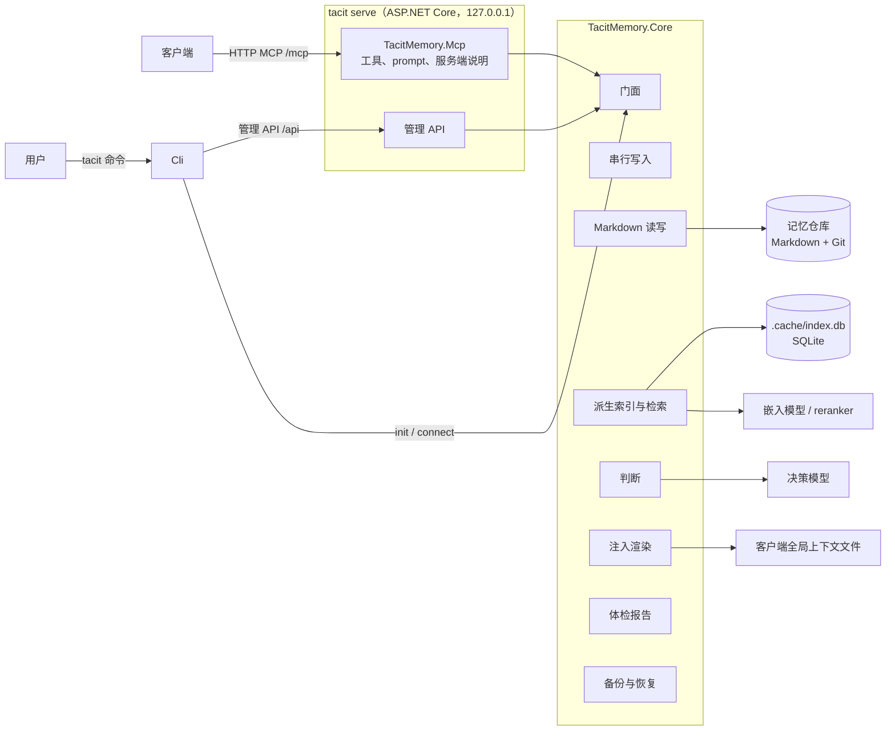

# TacitMemory 架构

本文档记录代码如何组织：程序集边界、模块分工、数据流与外部依赖。系统行为、接口与规则见 `docs/design.md`，术语见 `GLOSSARY.md`。代码结构变化时同步更新。本文描述目标结构，其中部分模块尚未实现。

## 1. 总览

## 2. 程序集

| 程序集 | 职责 | 依赖 |
| :--- | :--- | :--- |
| `TacitMemory.Core` | 全部记忆规则：存储读写、写入校验与上限、索引与检索、判断、注入渲染、体检报告、客户端适配、备份恢复、Git 提交、文件监听、本地化文本与英文模板。仅公开门面接口与契约类型，其余为 `internal` | 无内部依赖 |
| `TacitMemory.Mcp` | 将门面操作映射为 MCP 工具、prompt 与服务端说明，不含业务规则 | `Core` |
| `TacitMemory.Cli` | `tacit` 命令与 `serve` 进程：挂载 MCP 端点与管理 API；其余命令经管理 API 调用服务，`init`、`connect`、`disconnect` 直接调用门面 | `Core`、`Mcp` |

## 3. Core 内部模块

| 模块 | 职责 |
| :--- | :--- |
| 初始化 | `init`：生成 `config.yaml` 与 `rules.md` 模板，创建记忆仓库骨架并提交；已有文件不覆盖 |
| 门面 | 对外的唯一入口：检索、各类写入、体检报告、注入内容、绑定、备份恢复、状态 |
| 串行写入 | 所有写入排入单一队列；每次写入：校验 → 判断 → 改文件 → 同步索引 → Git 提交 → 必要时重渲染常驻区块 |
| Markdown 读写 | 解析各文件格式（识别所有语言的结构词）、按行定位修改、计算短码、记录格式问题 |
| 派生索引与检索 | SQLite FTS5 与 `vec0` 建表与增量同步；中文两字切分；RRF 合并；调用 reranker；索引版本校验与重建 |
| 判断 | 五个判断的问题模板（英文）与近邻筛选；三档阈值；凭据正则；降级 |
| 决策模型接口 | 与模型无关的三种题型（选择、打分、真伪）；TypeSafe 适配器 |
| 注入渲染 | 常驻区块渲染与标记校验；服务端说明生成（记忆规则、语言规范、近期摘要、已有项目、体检提示）；4000 字符上限校验 |
| 客户端适配 | omp、Claude Code 与文件三种绑定：定位上下文文件、注册与注销 MCP；`bindings.json` 读写 |
| 体检报告 | 现场计算重复、冲突、可确认候选、格式问题与主线过期 |
| 备份与恢复 | zip 打包与解包、保留份数、远端推送；恢复时暂停写入队列 |
| Git | 经 `SimpleExec` 调用 `git` 命令行：初始化、按文件提交、查询提交时间、推送 |
| 文件同步 | 启动时按哈希增量同步；运行时 `FileSystemWatcher` 监听，忽略服务自身写入引起的事件 |
| 本地化 | 面向人的短文本与结构词：每一项以中英两种写法一并定义，缺一种即无法编译；面向 Agent 的英文文本只有一份 |

## 4. 数据流

### 写入

1. MCP 工具调用进入门面，按 `op` 校验参数，排入串行队列；
2. 凭据检测；校验上限、必填线索、短码；
3. 需要时调用嵌入模型取近邻，再由决策模型判断（重复页、同主题活动、同一偏好、画像冲突）；
4. 按行修改 Markdown 文件，更新受影响的索引条目；
5. 用 `git` 只提交本次写入的文件。调用一律加 `-c core.quotepath=off` 并以 UTF-8 读取输出，避免中文路径被转义或乱码；
6. 画像变化时重新渲染各已绑定文件中的常驻区块；当天首次写入后触发自动备份。

### 检索

1. 按所属项目与日期筛选（普通 SQL）；
2. 全文：FTS5（unicode61 分词），中文在写入索引与查询前统一切成相邻两字一组，单字查询退回 `LIKE`；
3. 向量：`vec0`（余弦距离），单位为小节、页面的 `title + aliases`、活动条目；
4. 两路各取前 N 条，RRF 合并后交 reranker，按阈值过滤并截取前 K 条。

### 注入

- 客户端每次连接时，Mcp 向门面请求服务端说明，现场生成。
- 画像文件变化（经服务写入或文件监听发现）时，注入渲染重写所有已绑定文件中的常驻区块；结果未变不写。

### 索引重建

索引记录表结构版本、嵌入模型名称与向量维度；任一与当前配置不一致即删除并从 Markdown 全量重建。不使用表结构迁移。

## 5. 进程与传输

- `serve` 进程中的 ASP.NET Core 主机只监听 `127.0.0.1:<port>`，不做鉴权。
- MCP 端点挂载于 `/mcp`，使用 SDK 默认的无状态模式；服务端说明按连接现场生成。
- 管理 API 挂载于 `/api`，供 `status`、`reindex`、`backup`、`restore` 使用，将来的 Web UI 也走这里。

## 6. 外部依赖

| 用途 | 选用 |
| :--- | :--- |
| 索引驱动 | `Microsoft.Data.Sqlite` |
| 向量 | `sqlite-vec` 官方发布的 Windows x64 可加载扩展 `vec0.dll`（v0.1.9），随程序打包，锁定版本并校验 SHA-256；不使用 NuGet 上的第三方包 |
| 查询与映射 | `Dapper` |
| HTTP MCP 服务 | `ModelContextProtocol.AspNetCore` |
| Markdown 小节 | `Markdig` |
| YAML（页头、配置） | `YamlDotNet`（表示模型）；`config.yaml` 由 Core 逐项读取与校验，一次报告全部出错的键路径，不接入框架配置系统 |
| CLI | `ConsoleAppFramework` |
| 调用 `git` | `SimpleExec`（只用 `ReadAsync`：不回显命令，可指定编码与取消，非零退出码抛出带输出的异常） |
| 嵌入 | `Microsoft.Extensions.AI` + OpenAI 适配包，调用 OpenAI 兼容的 `/v1/embeddings` |
| reranker | `HttpClient` 类型化客户端，调用 Cohere/Jina 兼容的 `/v1/rerank` |
| 决策模型 | `HttpClient` 类型化客户端，调用 TypeSafe 的 `/v1/systemone` |
| 重试与超时 | `Microsoft.Extensions.Http.Resilience` |

依赖原则：一个依赖能解决实际问题或简化逻辑就引入，避开停更或附带额外条款的包。不引入中文分词库、表结构迁移库与 EF Core（与 FTS5、`vec0` 虚拟表不合）。具体版本在建项目时锁定。
