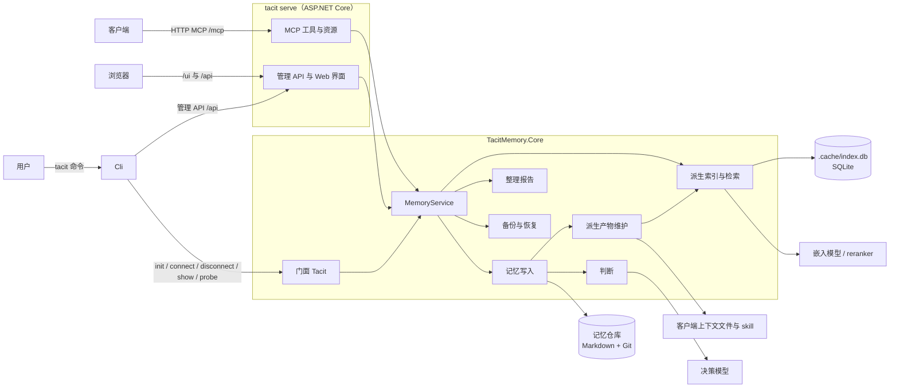

# TacitMemory 架构

本文档是代码的地图：程序集边界、模块分工、数据流与外部依赖。每个模块怎么实现，看代码；系统行为与规则见 `docs/design.md`，术语见 `GLOSSARY.md`。

## 1. 总览

## 2. 程序集

| 程序集 | 职责 | 依赖 |
| :--- | :--- | :--- |
| `TacitMemory.Core` | 全部记忆规则。只公开门面 `Tacit`、常驻服务 `MemoryService`、访问控制 `AccessControl` 与契约类型，其余都是 `internal` | 无 |
| `TacitMemory.Host` | HTTP 入口，分 `Mcp/`（工具、资源、工具目录）、`Api/`（管理 API 及其防护）、`Web/`（托管 `/ui`）三块。只做映射与防护，不含业务规则；宿主自己的文字在 `Localization/HostMessages` | `Core` |
| `TacitMemory.Cli` | `tacit` 命令。`Program.cs` 是唯一读进程与环境的地方，命令只经 `CliConsole` 读写控制台。需要服务的命令经 `ManagementApiClient` 调用管理 API，其余直接调用门面。退出码：2 用法错误，3 配置无效，4 服务未运行或端口被占，1 其他失败 | `Core`、`Host` |

`Cli` 引用 `Host` 只为挂载端点、读取工具说明、管理 API 的请求体与 JSON 约定，以及宿主的输出文字。

## 3. Core 模块

| 模块 | 职责 |
| :--- | :--- |
| 门面 `Tacit` | 对外唯一入口：打开服务、生成 skill、绑定、查看、探测、离线状态报告 |
| `MemoryService` | 分两层：外壳随进程存在（访问控制、客户端记录、派生产物维护）；运行时由配置决定（索引、辅助模型、记忆工具、备份、来源监听），启动与重新加载走同一条路径 |
| 串行与维护 | `MaintenanceGate`：写入与后台任务依次进行，读取共享；维护操作（重建索引、恢复、保存设置）独占 |
| 配置 | 每个键只在键表 `Configuration/ConfigKeys` 声明一次；加载、写出、设置页 schema、重启比对、只读与密钥处理都从它派生 |
| 重新加载 | 关闭运行时后按新配置重开，需重启的项保留运行中的值，失败时按原配置重开 |
| 记忆写入 | 三个写入工具把改好的文件交给 `MemoryWriter`：写文件、只提交这一个文件、同步索引，再通知「哪类来源写了」 |
| 仓库布局 | `MemoryLayout`：记忆仓库里每种文件的路径，读写两侧都经它取 |
| 各类记忆文件 | 画像与候选、细节页、近期活动、主线文件、汇总，各有解析与按行修改；解析时同时报告格式问题 |
| 判断 | 写入前的检查与整理的判断都把选择题交给 `ChoiceJudge`，它补上「都不是」、调用决策模型、按阈值分三档 |
| 派生索引与检索 | SQLite FTS5 + `vec0`，按来源组织；`RecallPipeline` 做筛选、全文、向量、RRF、精排；读取入口 `MemoryReader` 必须写明是否计入使用统计 |
| 主线简报 | `WorkstreamBrief`：只给主线名的 `recall`，直接读文件组装，不经检索 |
| 记忆浏览与检索追踪 | Web 界面的只读视图与 `recall` 的逐阶段明细，都不计入使用统计 |
| 辅助模型 | 三个模型共用请求内重试与冷却；提供方差异只在构造请求与读取响应两处 |
| 派生产物维护 | `DerivedUpkeep`：收到「来源变了」，按来源决定刷新索引、服务端说明缓存、常驻区块、skill；去抖 300 ms，重试用尽时把索引标为「可能过期」，下次检索前全量同步 |
| 注入 | 常驻区块渲染、服务端说明组装与长度截断、三个 skill 的生成 |
| 整理报告 | 现场计算，作为资源 `tacit://consolidation-report` 返回；判断经共享的判断工作池（并发上限、缓存、限时） |
| 客户端绑定 | `connect` 与 `disconnect`：常驻区块、skill 链接、`bindings.json`；不读写任何客户端的 MCP 配置 |
| 状态报告 | `tacit status` 与 `/api/status` 共用；服务未运行时给离线报告 |
| 备份与恢复 | 自动、手动、保险与云端备份共用一种打包；恢复先校验，再换入，失败时逆序撤销 |
| 访问 | 访问密码（PBKDF2）、签名 Cookie 会话、按对端地址的登录限速 |
| 日志 | 写与读两端共用 `ServiceLogFiles` 定义的格式；记忆工具调用与管理 API 调用各只在一处记录 |
| 本地化 | 面向人的短文本以 `Localized(Zh, En)` 定义，缺一种写法即无法编译；面向 Agent 的文字只有英文 |

## 4. 数据流

### 写入

1. 工具调用进入 `MemoryService`，取得写入锁。
2. 写入工具校验参数、检测凭据、核对短码，需要时让决策模型判断（重复页、同主题、画像冲突、同一偏好）。判断在写入锁内，所以判断看到的状态与写入时一致。
3. `MemoryWriter` 写入并只提交这一个文件；提交失败时文件照样算写入，下次写这个文件时一并提交。
4. 同步该来源的索引与向量，再通知 `DerivedUpkeep`：使服务端说明失效，画像变化时重渲染常驻区块，当天首次写入时安排自动备份。

调用 `git` 一律加 `-c core.quotepath=off` 并以 UTF-8 读取输出，否则中文路径会被转义。

### 检索

按主线与日期筛选 → 全文（FTS5，中文两字切分）与向量（`vec0`）各取候选 → RRF 合并 → reranker 精排 → 按阈值过滤与截取。`recall` 计入使用统计，记忆浏览与检索追踪不计入。

### 注入

服务端说明生成后缓存，记忆文件、提交或提示词文档变化时失效，每次取用时再比对一次状态（不可用的模型、当天日期）。记忆变化时重渲染所有已绑定文件里的常驻区块；skill 只取决于代码与 `prompts/`，记忆变化不会重写它们。

### 来源变化

`FileSourceWatch` 监听记忆仓库与 `prompts/`，回调只把事件翻译成「来源变了」交给 `DerivedUpkeep`。服务自己写入后已立即同步，随后的监听事件因哈希相同而跳过；外部编辑器的修改经同一条路径生效。

## 5. 进程与传输

- `serve` 总是监听 `127.0.0.1`，`server.host` 给出的额外地址监听同一端口；访问按连接来源区分本机与其他设备。
- `/mcp` 用 SDK 的无状态模式。工具与资源由 `MemoryTools`、`MemoryResources` 声明，只做转交。不声明 prompt，但 prompt 列表端点必须始终返回空列表：有的客户端不看声明的能力照样请求，失败就丢弃整个服务器。
- 工具参数的必填与取值用标注声明，取值只在 Core 的 `ToolValues` 定义一次。SDK 会丢弃未知参数名，所以 Mcp 层从原始调用里找出未知参数交给 Core，拒绝文字全部由 Core 给出。
- `/api` 是管理 API，`tacit` 命令与 Web 界面都经它访问服务；`/api/openapi.json` 由框架生成，仓库里的快照 `web/openapi.json` 是前端类型的来源。
- `/ui` 托管可执行文件旁 `web/` 目录的构建产物，`/` 重定向到 `/ui/`。路径逐段检查后再规范化，确认仍在目录之内。

## 6. 外部依赖

| 用途 | 选用 |
| :--- | :--- |
| MCP 服务 | `ModelContextProtocol.AspNetCore`（不引入扩展包） |
| YAML | `YamlDotNet`；`config.yaml` 由 Core 逐项读取，不接入框架配置系统 |
| CLI 与输出美化 | `ConsoleAppFramework`；`Spectre.Console` 只在 CLI 中用 |
| 调用 `git` | `SimpleExec` |
| 索引 | `Microsoft.Data.Sqlite`（关闭连接池，以便删除重建）、`Dapper` |
| 向量 | `sqlite-vec` 官方发布的 loadable 扩展，按平台存于 `lib/sqlite-vec/<rid>/`，加载前校验 SHA-256 |
| 辅助模型、WebDAV | 只用 `HttpClient`，不引入 SDK |
| 日志 | `Serilog`；Core 只引用日志抽象 |
| 版本与许可清单 | `MinVer`；`nuget-license` 与 `rollup-plugin-license` |
| 前端 | Bun、Vite、React、React Router、TanStack Query、Tailwind、`radix-ui`、CodeMirror、`@lezer/markdown` |

依赖原则：一个依赖能解决实际问题或简化逻辑就引入，避开停更或附带额外条款的包；进入发行包的依赖必须是与 Apache-2.0 相容的宽松许可，打包时校验，不合即失败。不引入中文分词库、表结构迁移库与 EF Core（与 FTS5、`vec0` 虚拟表不合）。不引入 Markdown 解析库：按行修改要求原样保留其余字节，语法树帮不上。

## 7. 前端工程（`web/`）

| 路径 | 内容 |
| :--- | :--- |
| `web/openapi.json`、`src/api/schema.ts` | OpenAPI 快照与由它生成的类型 |
| `src/api/` | 类型化客户端 `client.ts`（路径与参数写错即类型检查失败）与按端点分的查询和命令；每个命令在旁边声明它让哪些查询失效（`*_AFFECTS`），页面只调用 `afterCommand` |
| `src/app/` | 根布局（会话与登录跳转）、外壳（侧边栏）、路由表 |
| `src/pages/<页面>/` | 每个页面一个目录；不含界面的逻辑放在同目录的纯函数模块里并带测试。其他页面不从某个页面的目录导入 |
| `src/lib/` | 跨页面的纯函数。`routes.ts` 构建与解析界面的所有地址，路由表、侧栏与站内链接都由它生成，页面不手拼地址 |
| `src/components/` | 跨页面的部件：查询结果的四态、命令失败的分类、吸顶条（发布条下边界 `--sticky-bar-bottom`，页面不自己测量）等；`ui/` 是由 shadcn/ui 生成后改用令牌的基础组件 |
| `src/i18n/` | 中英两份字典。中文字典是类型基准，英文以 `satisfies` 对齐，多键少键都编译失败；字典不导入页面 |
| `src/styles/` | 设计令牌与只映射令牌的 Tailwind 主题，界面只能使用令牌（见 `docs/dev/ui-design.md`） |

**构建与托管**：`dotnet publish` 时构建前端并复制到发布目录的 `web/`；`dotnet build` 与 `dotnet test` 不触发前端构建。

**发行包**：`build/package.sh` 按目标平台生成单文件、裁剪且压缩的可执行文件，并把该平台的向量扩展放在旁边。裁剪只针对框架，所以全部 JSON 都经构建时生成的契约读写，产品代码每次构建都运行裁剪分析器（警告即错误）。发布规则见 `docs/reference/operations.md`。

**开发**：`bun run dev` 启动 Vite 开发服务器，`/api` 代理到本机运行中的服务（端口取 `TACIT_SERVICE_PORT`，缺省 18888）。
