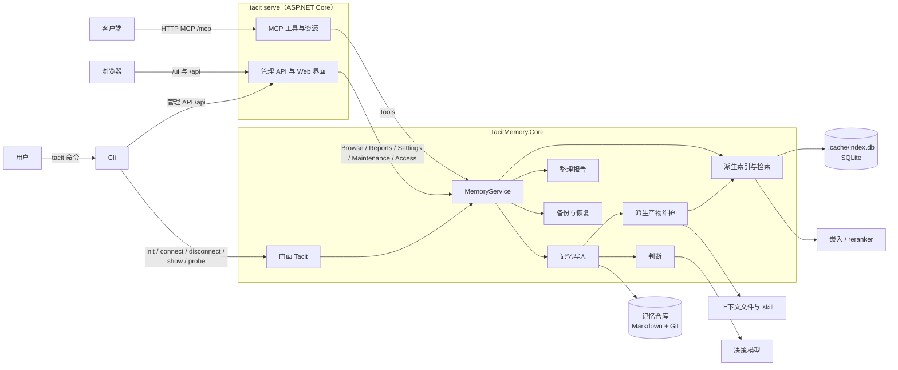

# TacitMemory 开发指南

本文档提供代码地图、程序集边界、前端结构、测试接缝与常用开发命令。系统行为规则见 [`design.md`](design.md)，架构取舍见 [`decisions.md`](decisions.md)。

## 1. 架构总览



### 程序集边界

| 程序集 | 职责 | 依赖 |
| :--- | :--- | :--- |
| `TacitMemory.Core` | 全部记忆与业务规则。仅公开门面 `Tacit`、`MemoryService` 及其子门面（`Tools`、`Browse`、`Reports`、`Settings`、`Maintenance`、`Access`）、契约类型与 `Localized`，其余均为 `internal` | 无 |
| `TacitMemory.Host` | HTTP 入口，分 `Mcp/`、`Api/`、`Web/` 三块，只做协议映射与安全防护，不含业务规则 | `Core` |
| `TacitMemory.Cli` | 命令行入口。`Program.cs` 唯一读取进程与环境，命令经 `CliConsole` 读写控制台；需服务的命令调用管理 API，其余直调门面 | `Core`、`Host` |

### Core 核心模块与数据流

- **`MemoryService`**：分为进程级外壳（读写锁 `MaintenanceGate`、访问控制、客户端记录、派生产物维护 `DerivedUpkeep`、重载生命周期）与配置级运行时（索引、辅助模型、工具、备份、同步、文件监听），启动与重载走同一构建路径。
- **配置与布局**：所有配置键在 `Configuration/ConfigKeys` 单一声明并派生加载、写出、设置页 schema 与密钥处理；仓库文件路径由 `MemoryLayout` 统一管理。
- **写入流**：工具经 `MemoryService.Tools` 取写锁 → 开启同步时先拉取 → 参数校验、凭据检测、短码核对与 `ChoiceJudge` 判断 → `MemoryWriter` 按行改文件并单文件提交 → 同步索引 → 通知 `DerivedUpkeep` 刷新服务端说明、常驻区块与后台推送/自动备份。调用 `git` 一律加 `-c core.quotepath=off` 并以 UTF-8 读取。
- **检索流**：`RecallPipeline` 按主线与日期筛选 → FTS5 全文与 C# 零拷贝 SIMD 余弦向量召回 → RRF 融合 → 有界 1-hop 派生页图扩展（`supersedes` 活跃替代追踪 + `related` 关联邻居）→ Reranker 精排 → 白盒调分（替代继承、已推翻降权、通用检索活动先验与温和衰减）→ 两层通用门控与格式化。读取入口 `MemoryReader` 要求显式声明是否计入使用统计。
- **外部变化**：`FileSourceWatch` 监听记忆仓库与 `prompts/`，经 `DerivedUpkeep` 300 ms 去抖刷新；失败重试 5 次后将索引标为可能过期，下次检索前全量兜底。

### 主要依赖

- **后端**：`ModelContextProtocol.AspNetCore`、`YamlDotNet`、`ConsoleAppFramework`、`Spectre.Console`、`SimpleExec`、`Microsoft.Data.Sqlite`（关闭连接池以便删除重建）、`Dapper`、`Serilog`、`MinVer`；辅助模型与 WebDAV 直接使用 `HttpClient`。
- **前端（`web/`）**：Bun、Vite、React、React Router、TanStack Query、Tailwind、`radix-ui`、CodeMirror、`@lezer/markdown`。

### 前端工程结构（`web/`）

- `web/openapi.json`、`src/api/schema.ts`：管理 API 的 OpenAPI 快照与生成的类型。
- `src/api/`：类型化客户端与查询/命令封装，命令旁声明失效范围（`*_AFFECTS`）。
- `src/app/` & `src/pages/<页面>/`：外壳布局、路由与各页面目录（纯逻辑拆同目录模块并附单元测试，页面间不互相导入）。
- `src/lib/`：`routes.ts` 统一构建解析路由；`appearance.ts` 管理浏览器端明暗与调色盘状态及切换动效。
- `src/components/`、`src/i18n/`、`src/styles/`：复用组件、中英双语字典（中文为类型基准）与设计令牌。

本地前端开发可运行 `bun run dev`，`/api` 默认代理到本机 `18888` 端口（可用 `TACIT_SERVICE_PORT` 覆盖）。

## 2. 测试接缝与约定

测试均围绕公开契约编写，不调用真实模型或公网，使用进程内 HTTP 替身（`ModelDouble`、`WebDavDouble`）与本地临时裸仓库模拟同步：

1. **`tests/TacitMemory.Core.Tests`（门面接缝）**：通过 `Core` 公开门面测试，每个用例使用独立的临时 `TestHome` 与真实 `git`；异步刷新通过 internal 入口 `SettledAsync` 与测试时钟 `TestHome.Clock` 确定性推进。
2. **`tests/TacitMemory.Host.Tests`（MCP 与 API 接缝）**：进程内启动真实 HTTP `ServiceHost`，以 `127.0.0.2` 模拟其他设备连接。
3. **`tests/TacitMemory.Cli.Tests`（CLI 接缝）**：进程内经 `CommandLine.RunAsync` 与 `CliConsole` 执行命令；因静态状态限制，测试类均须标注 `[Collection(CliCollection.Name)]`。
4. **`benchmarks/TacitMemory.Benchmarks` 与 `tests/TacitMemory.Benchmarks.Tests`（检索与性能基准）**：独立控制台工具（不进发行包），`recall` 严格经 `Core` 公开门面 `TraceRecallAsync` 评测召回率与四阶段漏斗，`perf` 经 `InternalsVisibleTo` 拆测派生索引与端到端性能；配套测试统一经进程内 CLI 入口与 `ModelDouble` 验证内置脱敏语料、指标口径、细粒度缓存代理与性能冒烟。

> **macOS 本地运行 Host / CLI 测试**：macOS 默认仅有 `127.0.0.1` 回环地址，需先添加别名（重启后失效）：
> ```bash
> sudo ifconfig lo0 alias 127.0.0.2 up
> ```

## 3. 常用开发与检查命令

### .NET 测试与格式

```bash
dotnet test tests/TacitMemory.Core.Tests
dotnet test tests/TacitMemory.Host.Tests
dotnet test tests/TacitMemory.Cli.Tests
dotnet test TacitMemory.slnx                        # 全量测试

dotnet format --verify-no-changes TacitMemory.slnx  # 格式检查
dotnet format TacitMemory.slnx                      # 就地格式化
```

### 更新 OpenAPI 快照

修改管理 API 的请求或响应契约后，重新生成 `web/openapi.json` 并验证：

```bash
TACIT_UPDATE_OPENAPI=1 dotnet test tests/TacitMemory.Host.Tests --filter "FullyQualifiedName~OpenApiTests"
dotnet test tests/TacitMemory.Host.Tests --filter "FullyQualifiedName~OpenApiTests"
```

### 前端检查（`web/`）

不需要启动服务或安装 .NET：

```bash
cd web
bun run check   # 类型检查、ESLint、Prettier、Vitest 与生产构建
bun run format  # Prettier 就地格式化
```

### 发行包冒烟

因测试跑在未裁剪构建上，`build/smoke.sh` 是验证裁剪发行包完整性的关键检查（覆盖 CLI、管理 API、四个 MCP 工具、索引重建、备份恢复预览与 Web 界面）：

```bash
build/smoke.sh <发布目录> [<期望版本>]
```
