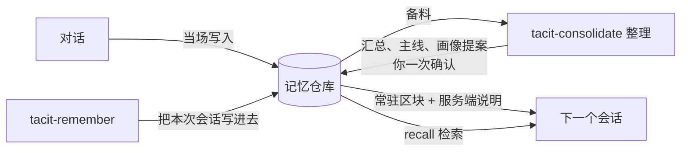

# TacitMemory 概览

先读这一篇。它讲 TacitMemory 是什么、用户看到什么、整体怎么搭起来，以及想深入时去读哪份文档。

## 它是什么

TacitMemory 是一个跨客户端的个人记忆系统。Agent（Claude Code、omp 等任何支持 MCP 与 skill 的客户端）在对话中把值得记住的事写进记忆，下次会话开始时就已经知道你是谁、在忙什么、以前踩过什么坑。

三个基本立场决定了它的形状：

- **记忆是你的文件**：所有记忆都是 Markdown，放在一个独立的 Git 仓库里，你可以直接读、直接改、用 Git 看历史。检索索引只是派生缓存，随时可以删掉重建。
- **理解交给主会话**：写什么、怎么写、怎么归纳，全部由你正在对话的那个 Agent 判断。服务自己不调用生成模型，只做存储、校验、判断与检索，行为可预测。
- **通用，不绑定客户端**：只依赖 MCP 与 skill 这两种各家都有的机制，不用客户端钩子，也不替你改客户端的配置。

## 记忆里有什么

| 记忆 | 内容 | 什么时候被 Agent 看到 |
| :--- | :--- | :--- |
| **画像** | 红线、协作规则、偏好、档案。分全局、领域、主线三种作用域 | 全局的每次会话都在；领域的按需取；主线的在进入那条主线时 |
| **主线** | 每件持续进行的事（一个项目、一台服务器的运维）一条：背景说明与近况 | 每次会话都在（最近 28 天有活动的附近况） |
| **活动记录** | 每次会话的结论，一条一行，按月存放；整理时写周汇总与月汇总 | 最近 7 天的随会话下发，更早的按需检索 |
| **细节页** | 一件事一页：排错、决定、实体、工作记录四种 | 按需检索 |

前两种体积小、变化慢，常驻上下文；后两种量大，Agent 用 `recall` 去取。

## 记忆怎么流动

- **捕获**：Agent 在对话中遇到值得记的事（你纠正了它、拍板了方案、查明了根因）就当场写。你纠正它或说出一条做法时，它会问一次「要记成长期规则吗」。会话快结束时，你也可以触发 `tacit-remember` 让它把本次会话补写进去。
- **整理**：隔一段时间触发 `tacit-consolidate`。Agent 先自动处理格式问题、写周与月汇总、更新主线近况；再把需要你拍板的事（画像提案、页面重组、冲突条目）编成一张编号清单，你一次回复决定。该整理时，新会话会提醒你。
- **供给**：会话开始时，客户端的上下文文件里已经有常驻区块（画像、领域索引、主线），服务端说明里有核心规则与最近 7 天的活动；其余的 Agent 按需检索。

写入时，服务会用一个小的决策模型判断「是不是重复的页」「是不是同一件事」「和已有规则冲突吗」，拿不准的留给整理。检索时，全文与向量两路取候选，融合后由 reranker 精排。三个辅助模型都可以不配置，缺了哪个就按降级规则少做一步。

## 你会用到的东西

- **`tacit` 命令**：`init` 初始化、`serve` 启动常驻服务、`connect` 把一个客户端绑上（写常驻区块、链接 skill）、`status` 看全局状况、`backup` 与 `restore` 备份恢复。`tacit --help` 列出全部命令。
- **Web 界面**（`http://127.0.0.1:18888/ui`）：
  - 仪表盘：服务是否正常、有什么要处理、近一年的记忆活动；
  - 设置：取代手写 `config.yaml`；
  - 提示词：调整 Agent 收到的规则与常驻区块措辞；
  - 日志；
  - 记忆：只读地浏览画像、主线、细节页、活动，以及「为什么这条没搜到」的检索追踪。
  设了访问密码与额外监听后，也可以从其他设备打开。
- **记忆仓库**：默认在 `~/.tacit/memory`，可以用任何编辑器直接改，服务会监听变化并同步索引。

## 整体结构

只有一个常驻服务，所有写入都在它里面串行完成，所以多个客户端同时用也不会互相覆盖。MCP 端点只接受本机连接；Web 界面与管理 API 在本机免登录，从其他设备访问要先登录。

## 文档地图

| 想知道 | 读 |
| :--- | :--- |
| 系统具体怎么运作：写入、检索、注入、整理、运行、Web 界面的每条规则 | `docs/design.md` |
| 为什么这样设计、考虑过哪些别的做法 | `docs/decisions.md` |
| 记忆文件怎么写 | `docs/reference/memory-files.md` |
| 每个配置项是什么 | `docs/reference/configuration.md` |
| MCP 工具与参数 | `docs/reference/mcp.md` |
| 文件在哪、怎么备份、怎么排障、怎么发布 | `docs/reference/operations.md` |
| 术语 | `GLOSSARY.md` |
| 写代码时的规则：架构地图、测试、提示词、界面规范 | `docs/dev/` |

细节不懂时，直接问 Agent，让它去读代码。
