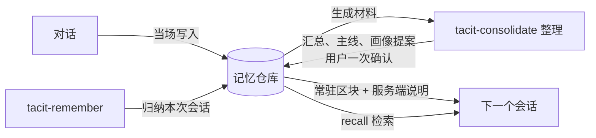
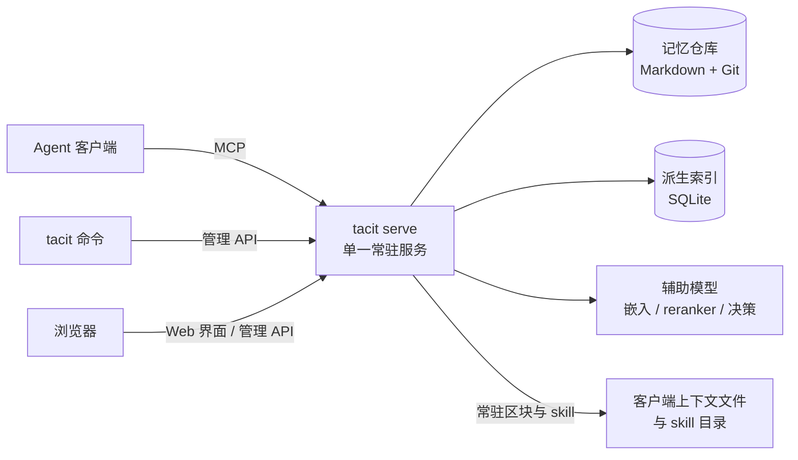

# TacitMemory 概览

本文介绍 TacitMemory 的核心定位、功能组成、数据流向以及完整文档导航。

## 核心定位

TacitMemory 是一个跨客户端的个人记忆系统。支持 MCP 与 skill 的 Agent 客户端（如 Claude Code、Codex、Cursor 等）可在对话过程中记录长期偏好、近期活动与历史排错经验，并在后续新会话开始时恢复上下文。

系统设计遵循以下三项核心原则：

- **文件是唯一真相源**：所有记忆均以 Markdown 格式保存在独立 Git 仓库中，可直接阅读、编辑与追溯提交历史。检索索引属于派生缓存，可随时删除并重建。
- **理解与生成交给主会话**：写入内容、归纳摘要与整理提案均由当前对话的 Agent 完成。常驻服务自身不调用生成式对话模型，仅负责存储校验、结构化判断与检索，保证行为可预测。
- **跨客户端通用**：仅依赖 MCP 与 skill 两项通用机制，不依赖特定客户端钩子，也不代写客户端配置文件。

## 记忆分层

| 记忆类型 | 内容范围 | 注入时机 |
| :--- | :--- | :--- |
| **画像** | 红线、协作规则、偏好与档案，分为全局、领域、主线三种作用域 | 全局条目随会话常驻；领域条目按需读取；主线条目随主线简报读取 |
| **主线** | 持续进行的工作或事务（项目、服务器运维等），包含背景说明与近期摘要 | 随会话常驻（最近 28 天内有活动的主线附加近期摘要） |
| **活动记录** | 会话结论，每条一行并按月归档；整理时生成周汇总与月汇总 | 最近 7 天的活动随会话下发，更早记录按需检索 |
| **细节页** | 按主题组织的 Markdown 页面，分为排错、决定、实体、工作单元四种类型 | 由 Agent 通过 `recall` 按需检索 |

画像与主线体积可控且变化频率低，因此常驻上下文；活动记录与细节页随时间累积，由 Agent 按需检索获取。

## 工作流程

- **捕获**：Agent 在对话中识别到值得记录的结论（如用户纠偏、方案拍板、根因定位）后即时写入。当用户纠正 Agent 或明确提出协作方式时，Agent 会询问一次是否写入长期规则；在会话结束或压缩上下文前，也可由用户手动触发 `tacit-remember` 补充记录。
- **整理**：定期触发 `tacit-consolidate` 执行记忆整理。Agent 先自动修复格式问题、编写周/月汇总并更新主线近期摘要；再将需要决策的事项（画像提案、页面重组、冲突条目）汇总为编号清单，由用户一次回复确认。满足整理条件时，新会话的服务端说明会自动提示。
- **供给**：新会话启动时，客户端的上下文文件已包含常驻区块（全局画像、领域索引、主线），服务端说明包含核心规则与最近 7 天活动；其余细节由 Agent 通过 `recall` 检索。

写入阶段，常驻服务可借助决策模型执行重复页、同主题、同一偏好与规则冲突判断；处于不确定区间的结果不会自动合并或丢弃，而是留待整理阶段复核。检索阶段采用全文与向量双路召回，经融合后由 reranker 精排。三类辅助模型均为可选项，未配置或不可用时按降级规则处理。

## 交互入口

- **`tacit` CLI**：提供 `init`（初始化）、`serve`（启动服务）、`connect`（绑定客户端）、`status`（状态报告）、`backup` 与 `restore`（备份与恢复）等命令。完整命令列表可通过 `tacit --help` 查看。
- **Web 界面**（默认地址 `http://127.0.0.1:18888/ui`）：
  - **仪表盘**：展示服务健康度、待处理事项与近一年记忆活动热力图；
  - **设置**：可视化编辑 `config.yaml` 与管理客户端绑定；
  - **提示词**：查看与自定义发送给 Agent 的规则与引导语文档；
  - **日志**：只读查看服务运行日志；
  - **记忆**：只读浏览画像、主线、细节页、活动记录，以及执行检索追踪（排查特定内容未被命中的原因）。
  配置访问密码与额外监听地址后，可从其他设备通过浏览器访问 Web 界面。
- **记忆仓库**：默认位于 `~/.tacit/memory`，可使用任意文本编辑器直接修改，常驻服务会自动监听变更并同步索引。

## 系统架构

系统仅运行一个常驻 HTTP 服务实例，所有写入操作在服务内部串行执行，避免多客户端并发写入导致冲突。`/mcp` 端点仅接受本机回环连接；Web 界面与管理 API 在本机免登录，来自其他设备的访问须先登录鉴权。

## 文档导航

| 阅读目标 | 对应文档 |
| :--- | :--- |
| 写入、检索、注入、整理、运行与 Web 界面的完整规则 | [`docs/design.md`](design.md) |
| 架构决策、权衡依据与被放弃的备选方案 | [`docs/decisions.md`](decisions.md) |
| 记忆文件目录结构与 Markdown 书写规范 | [`docs/reference/memory-files.md`](reference/memory-files.md) |
| 环境变量、`config.yaml` 配置项与提示词文档校验规则 | [`docs/reference/configuration.md`](reference/configuration.md) |
| MCP 端点、工具参数与资源契约 | [`docs/reference/mcp.md`](reference/mcp.md) |
| 数据布局、备份恢复、Git 同步、日志排障与发布流程 | [`docs/reference/operations.md`](reference/operations.md) |
| 核心术语定义与禁用同义词 | [`GLOSSARY.md`](../GLOSSARY.md) |
| 代码地图、测试规范、提示词职责与界面设计规范 | `docs/dev/` |
